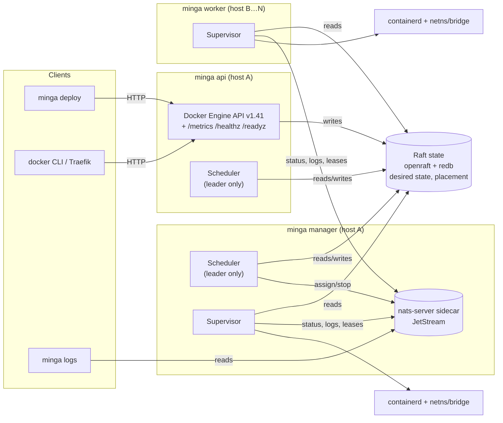
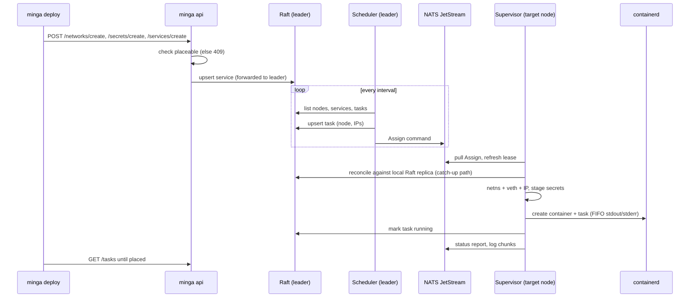
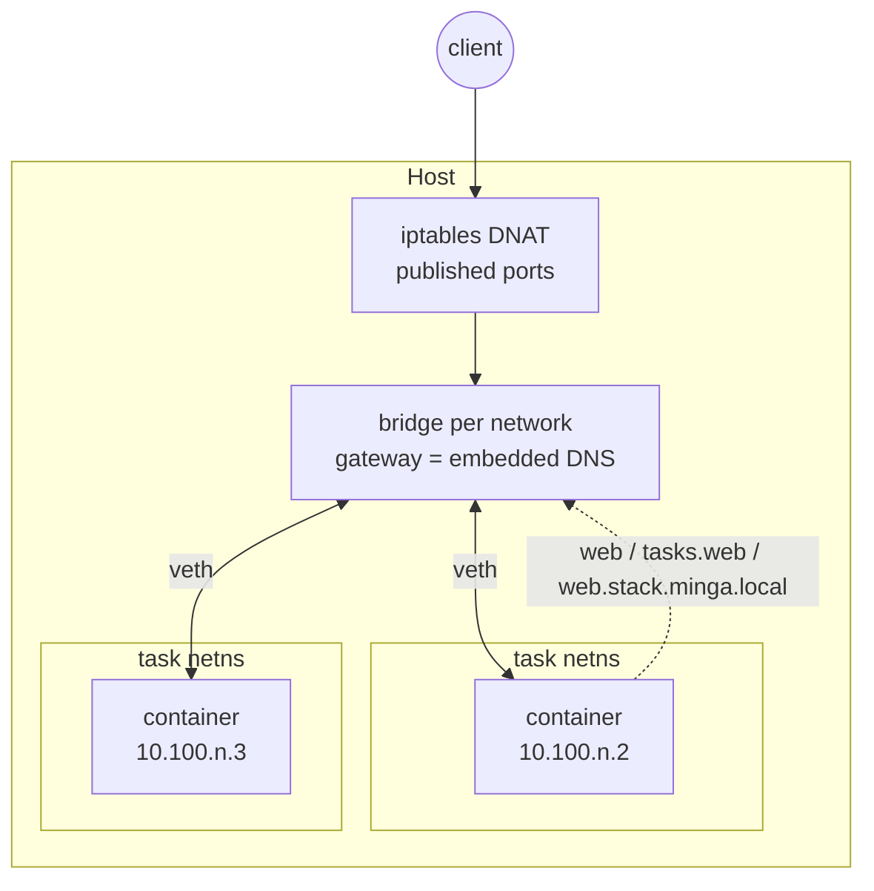
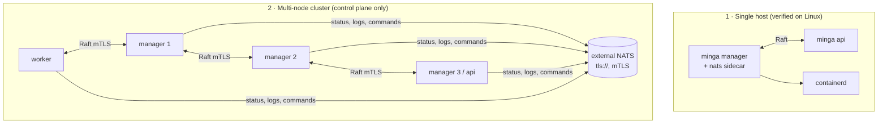

# Minga

[](LICENSE)
[](https://www.rust-lang.org)
[](CHANGELOG.md)

A single-binary container and agent orchestrator for **edge, on-prem and air-gapped sites**, written in Rust. It runs Compose files natively, speaks enough of the Docker Swarm API to replace it, and treats AI-agent workloads as first-class objects (WASM sandboxes and an LLM egress proxy today).

Named after the [minga](https://en.wikipedia.org/wiki/Minga) of Chiloé, where a community moves a whole house together.

> **Status: `v1.1.0`.** What works, verified by tests on macOS and in Linux CI (containerd suites and a real-kernel networking job); the [release notes](docs/release-1.1.0.md) say what was and was not run on a real node:
>
> - **Compose and deploy:** Compose parsing that fails loudly on unknown keys, and `minga deploy` through the Swarm-compatible Docker Engine API (v1.41, optional bearer token).
> - **Control plane:** Raft consensus with mTLS and write forwarding, a scheduler, and self-registering nodes with membership leases.
> - **Runtime and networking:** a node supervisor driving a **real containerd runtime**, per-task netns/bridge networking with IPAM and embedded DNS, and real container logs.
> - **Platform:** NATS/JetStream with TLS, WASM sandboxes, an LLM egress proxy, and Prometheus metrics with health endpoints.
> - **Updates:** rolling updates honoring `update_config`, enforced healthchecks, automatic rollback, and registry image pull through containerd's Transfer API with Docker credential helpers.
> - **New in `v1.1.0`:** versioned state, so later upgrades keep it; `minga state export` and `import` for backup and restore ([guide](docs/backup.md)); a failed task records its last error and exit code, shown by the Docker API and `minga-ctl service ps` and `service inspect`; image pulls that keep the credential off the command line and read `credsStore`/`credHelpers`; published ports that only redirect traffic addressed to the node, with host-local and hairpin access; supplementary groups from the image. **Upgrading from 1.0.2 needs one last removal of the Raft files**: see the [release notes](docs/release-1.1.0.md#upgrade-notes).
> - **`minga-ctl`**, the companion CLI for contexts, stacks, services, health and registry login over SSH (not in the release archive; `cargo install --locked --path crates/minga-ctl`, see [its plan](docs/minga-ctl-plan.md)).
>
> **Not in `v1.1.0`:**
>
> - Container networking across nodes: there's no WireGuard mesh yet.
> - Joining a node to a running cluster: Raft membership is fixed at bootstrap.
> - API roles, TLS on the API listener and a server-side audit log: designed in [ADR 0005](docs/adr/0005-api-identity-and-roles.md) (Proposed), not built. The API has one shared token.
> - A plain-HTTP registry on containerd 1.7 (the Transfer API has no plain-HTTP option there).
> - A run of this build on a real staging node, on Talos, or against a hosted private registry: see [the release notes](docs/release-1.1.0.md#verification-status).
>
> Details: [changelog](CHANGELOG.md), [release notes](docs/release-1.1.0.md), [production-readiness plan](docs/production-readiness-plan.md), [architecture notes](docs/architecture.md).
>
> The Talos install is validated on a single docker-provisioned Talos v1.14 node, not on bare metal. FIPS, SOC 2, VS-NfD and NATO are **not assessed**, which is not the same as "not applicable".

## Why Minga

Docker Swarm is a fine orchestrator for a datacenter, but it was not built for the places Minga targets:

- **Edge sites** with a handful of ARM boards, intermittent connectivity, and no tolerance for a heavyweight control plane.
- **Air-gapped environments** where pulling images from a registry is not an option and every dependency must be vendored.
- **Agent workloads** that need sandboxed execution, token budgets and LLM egress control, not just "run a container".

Minga ships as **one binary** (plus the `nats-server` it supervises). There's no Docker daemon, no Kubernetes and no etcd. It reads a `compose.yaml` and runs it, with Raft for desired state and NATS/JetStream for status, logs and liveness.

## Features

- **Compose-native.** Full spec parsing with interpolation, profiles, merge keys and `x-` extensions. Unknown keys fail loudly with suggestions. `command`, `entrypoint`, `labels`, `healthcheck` (gates task readiness), volumes, bind mounts, placement constraints and `deploy.restart_policy` reach the container.
- **Swarm-compatible API.** Services, tasks, nodes, networks, secrets and configs, with label filters. `docker stack deploy`, `docker service ls`, `docker node ls` and Traefik v3's swarm provider work against `minga api`.
- **Raft consensus.** Desired state and placement go through [openraft](https://docs.rs/openraft), persisted in [redb](https://docs.rs/redb) as versioned JSON: a node refuses data it cannot read and says why, and fields added later need no wipe. mTLS on the Raft transport and bounded frames. No external etcd.
- **Backup and restore.** `minga state export` writes services, networks, volumes and secret and config references to a 0600 file; `minga state import` restores them into a fresh cluster, where the scheduler places the tasks again. [docs/backup.md](docs/backup.md) lists what else to copy.
- **Container networking on a node.** Deterministic per-task IPs from IPAM (a /24 per network from `10.100.0.0/16`), one bridge per network, a netns and veth pair per task, iptables DNAT for published ports (traffic addressed to the node only, reachable from the node itself and from tasks through the node's address), and embedded DNS (`<svc>`, `tasks.<svc>`, `<svc>.<stack>.minga.local`). Cross-node traffic needs the WireGuard mesh, which is generated as config but not applied yet.
- **Secrets and logs.** Secrets are external references staged per task and content-addressed, so rotation never changes a running task's files. `minga logs [-f]` shows separated stdout/stderr from a JetStream-retained backlog.
- **Agent workloads.** `x-minga-agent` Compose services run as WASM modules under wasmtime with fuel and timeout limits. An LLM egress proxy enforces per-workload token budgets, caches responses and redacts secrets. Today the WASM guest gets no host I/O: no WASI, no network, so it can't reach the proxy yet. Memory limits aren't enforced, and Firecracker is a stub.
- **Observability.** `/metrics`, `/healthz` and `/readyz` on `minga api`, and on manager and worker nodes via `--metrics-bind`. JSON logs on stderr for long-running roles. A failed container task keeps its last error and exit code, returned in the Docker API's task status and shown by `minga-ctl service ps` and `service inspect`; an agent task records the error only when it fails to start.
- **Air-gap friendly.** Release archives bundle a checksum-pinned `nats-server`, and `install.sh` verifies `SHA256SUMS`. A task pulls a missing image through containerd's Transfer API on the configured socket, with credentials from Docker credential helpers or inline `auths` that never appear on a command line; air-gapped sites preload images with `minga image pull` or `ctr` instead.

## Architecture

Every role is the same `minga` binary. The manager runs the scheduler and the node supervisor, and spawns `nats-server` as a child process. Workers run the supervisor only. `minga api` serves the Docker Engine API and runs its own leadership-gated scheduler.



> In `v1.1.0` **every `minga` process is a Raft voter**, including workers and `minga api`, and membership is fixed when the cluster first starts. Only desired state should go through Raft. Node lease renewals still do, as one atomic command every 10s. [docs/architecture.md](docs/architecture.md) explains why this matters for cluster size and quorum, and what replaces it.

### How a deploy becomes a running container



### Networking on one node



### Design principles

- **Rust on the hot path.** Per-packet, per-request and per-sandbox work stays in Rust. Go components (embedded NATS) run as separate processes; there's no FFI. See [ADR 0001](docs/adr/0001-language-split.md).
- **Only desired state goes through Raft.** Heartbeats, task status and agent run steps belong on JetStream ([ADR 0002](docs/adr/0002-event-bus-nats.md)). Node leases don't follow this yet; see the note above.
- **Compose files deploy unchanged.** Unknown keys fail loudly instead of being skipped.
- **Simplicity over complexity.** One binary, and no external dependencies for consensus or storage.

## Crate layout

| Crate | Purpose |
| --- | --- |
| `minga-cli` | The `minga` binary: `manager`, `worker`, `api`, `deploy`, `validate`, `logs`, `tls`, `net`, `wg`, `sandbox`, `egress`, `agent`. Also manages the NATS sidecar. |
| `minga-compose` | Compose Specification parser and validator: interpolation, profiles, merge keys, `x-minga-agent`, cycle and port-conflict detection. |
| `minga-state` | Cluster state: openraft + redb, a TCP transport with optional mTLS, write forwarding to the leader, and an atomic lease-renewal command. |
| `minga-scheduler` | Compose → state translation, spread placement with constraints and capacity checks, per-task IP assignment, and the reconcile loop. |
| `minga-api` | Docker Engine API v1.41 subset (axum) with bearer-token auth and two-way translation between Docker and state types. |
| `minga-node` | Node supervisor. Containerd runtime over gRPC (OCI spec, FIFO log capture), netns/bridge/DNAT networking, embedded DNS, secret staging, restart policies, agent executor, self-registration. |
| `minga-bus` | `EventBus` trait with `MemoryBus` and `NatsBus` (JetStream commands, events, logs, KV status, leases) and NATS TLS. |
| `minga-net` | CIDR and IPAM, the DNS record store, WireGuard keys and `wg-quick` config generation (not applied yet). |
| `minga-sandbox` | `SandboxRuntime` trait: `WasmtimeRuntime` (fuel, timeout), `WarmPool`, a `FirecrackerRuntime` stub. |
| `minga-egress` | LLM egress proxy: per-workload token budgets, LRU response cache, secret redaction. |
| `minga-telemetry` | Prometheus registry, `/metrics`, `/healthz`, `/readyz` router, JSON logging. |

## Quick start: one Linux host

You need Linux, root (the supervisor creates netns, bridges and iptables rules), `iproute2` + `iptables` + `procps` (present in any standard server install; the container image bundles them), and containerd. A task pulls a missing image into the `minga` namespace through containerd's Transfer API on `--containerd-socket` (containerd 1.7 or newer for private registries). Registry credentials come from `$DOCKER_CONFIG/config.json`, else `~/.docker/config.json`: `credHelpers`, then `credsStore`, then inline `auths`.

```bash
# Installs minga + the checksum-pinned nats-server and verifies SHA256SUMS.
curl -fsSL https://github.com/lithqube/minga/releases/latest/download/install.sh | sh
# Same, plus the systemd unit and an /etc/minga/minga.env template:
#   curl -fsSL .../install.sh | sh -s -- --with-systemd
# Flags: --version vX.Y.Z, --prefix DIR, --uninstall (see install.sh --help).

# From source instead:
cargo build --release -p minga-cli
sudo install -m 0755 target/release/minga /usr/local/bin/minga

# Optional: preload images (air-gapped sites, private registries); otherwise a task pulls what it needs
sudo ctr -n minga images pull docker.io/library/nginx:1.27
```

Today `minga api` is its own Raft voter, so a single host runs two processes that peer with each other:

```bash
# Terminal 1: manager (scheduler + supervisor + NATS sidecar on 127.0.0.1:4222)
sudo minga manager --node-id 1 --bind 127.0.0.1:7001 --peer 2=127.0.0.1:7002 \
  --data-dir /var/lib/minga --runtime containerd --metrics-bind 127.0.0.1:9100
```

```bash
# Terminal 2: Docker Engine API on :2375
sudo MINGA_API_TOKEN=change-me minga api --node-id 2 --bind 127.0.0.1:7002 \
  --peer 1=127.0.0.1:7001 --data-dir /var/lib/minga-api --api-bind 127.0.0.1:2375
```

```bash
# Deploy, inspect, read logs
MINGA_API_TOKEN=change-me minga deploy -c compose.yaml shop
curl -s 127.0.0.1:9100/readyz
minga logs -f <task-id> --nats-url nats://127.0.0.1:4222
```

`minga validate -c compose.yaml` checks a Compose file offline and prints the startup order:

```
project plant-7
services in startup order:
  inference        registry.local/vllm:0.6.3                1 replica(s)
  agent-api        registry.local/agent-api:1.4.0           2 replica(s)  ports 443->8080/tcp  after inference
  sensors          registry.local/sensor-reader:2.1         global
  debug-ui         registry.local/debug-ui:latest           1 replica(s)  ports 9000->9000/tcp
```

**Agent workloads** (`x-minga-agent`) only run on nodes started with `--sandbox-runtime wasmtime`. Without it, the supervisor logs a warning and skips agent tasks. Stage each `.wasm` module on that node: a relative `module:` path resolves against `--module-dir` (default `/var/lib/minga/modules`), and an absolute path is used as is.

```bash
sudo minga manager … --sandbox-runtime wasmtime --module-dir /var/lib/minga/modules
```

For systemd, [`scripts/minga.service`](scripts/minga.service) runs either role from an environment file.

## Deployment topologies



1. **Single host.** This is the verified path: containers reach each other by service name, and published ports work. It's the quick start above.
2. **Multi-node.** Raft (with `--raft-tls-*`) and scheduling across nodes work. Three limits: every node must be listed with `--peer` and started together, containers on different nodes can't reach each other yet, and placement pauses if a worker wins the Raft election. The manager's NATS sidecar listens only on loopback, so **every manager and worker** must point at one external NATS server or cluster: a `tls://` URL (a comma-separated list for a cluster, with `--nats-replicas 3` on the managers so losing one NATS server loses no bus state) plus `MINGA_NATS_TLS_CA`, `MINGA_NATS_TLS_CERT`, `MINGA_NATS_TLS_KEY` and `MINGA_NATS_TLS_SERVER_NAME`. Those connections are certificate-only, since `--nats-token` is ignored over TLS. A manager left without `--nats-url` spawns its own private sidecar and splits the bus. Issue Raft certificates with `minga tls init-ca` and `minga tls issue-node`.
3. **Talos Linux.** **Validated single-node install** on Talos v1.14: Minga runs as two `ContainerConfig` containers pulled from GHCR — no system extension, no custom boot asset — and workload images preload via a Kubernetes Job using the bundled `ctr`. Guide: [docs/talos-deployment.md](docs/talos-deployment.md). Bare-metal and multi-node are not hardware-validated.
4. **Air-gapped.** Copy the release archive (with `minga`, `nats-server` and the licenses) and image tarballs to the site. Then run `ctr -n minga images import <image>.tar` on each node and start the roles as above. No step needs a network connection.

### Container image

The release workflow also pushes a multi-arch image (`linux/amd64`, `linux/arm64`) built from the same binaries as the archives: `ghcr.io/lithqube/minga` with tags `vX.Y.Z`, `X.Y` and `latest`. The image bundles `nats-server` next to `minga`, like the archive.

```bash
docker run --rm ghcr.io/lithqube/minga:latest --help

# Manager on a host: node roles need the host network, NET_ADMIN and
# SYS_ADMIN (or --privileged), the containerd socket, and two path-identity
# mounts: the data dir (runc resolves minga's OCI bind sources on the host)
# and /run/netns with shared propagation (netns handles must be visible to
# runc outside the container).
docker run -d --name minga \
  --network host --cap-add NET_ADMIN --cap-add SYS_ADMIN \
  -v /run/containerd/containerd.sock:/run/containerd/containerd.sock \
  -v /var/lib/minga:/var/lib/minga \
  -v /run/netns:/var/run/netns:rshared \
  ghcr.io/lithqube/minga:latest \
  manager --node-id 1 --bind 127.0.0.1:7001 \
    --data-dir /var/lib/minga --runtime containerd --metrics-bind 127.0.0.1:9100
```

For systemd hosts the installer stays the better path; the image exists for container-first environments.

### Install targets

| Target | Path | Status |
|--------|------|--------|
| Talos v1.14+ | `scripts/setup-talos-minga.sh` ([guide](docs/talos-deployment.md)) | Validated on docker-provisioned Talos v1.14.5 through workload start (arm64); bare-metal pending |
| Debian 11/12, Ubuntu 20.04/22.04/24.04, Fedora 32+ | `install.sh [--with-systemd]` | Install, run, uninstall verified per distro in containers (arm64) |
| Container-first Linux | `ghcr.io/lithqube/minga` | Image verified (arm64) |
| Other glibc ≥ 2.31 Linux | `install.sh` or the tarball | Covered by the bullseye build floor; untested |
| macOS | Build from source (development only) | Not a deploy target |

x86_64 binaries are built by the same workflow but the on-machine verification above ran on arm64.

## Development

```bash
git clone https://github.com/lithqube/minga.git && cd minga
cargo build
cargo fmt --all
cargo clippy --all-targets -- -D warnings
cargo test --workspace          # bus tests need `nats-server` on PATH
cargo run -p minga-cli -- --help
```

Requirements: Rust 1.80+ with `rustfmt` and `clippy`, and `nats-server` for the bus suites. On Linux, the daemon-backed suites run with `sudo -E env "PATH=$PATH" MINGA_REQUIRE_CONTAINERD=1 cargo test -p minga-node --test containerd --test containerd_client`, which fails instead of skipping when containerd is missing. See [CONTRIBUTING.md](CONTRIBUTING.md).

## Roadmap

`v0.1.0` closed seven gates, each with an executable exit criterion ([docs/roadmap-v0.1.0.md](docs/roadmap-v0.1.0.md)):

- [x] Gate 1: cluster membership (self-registration, leases, 409 on unplaceable deploys)
- [x] Gate 2: `minga deploy` deploys through the shared API write path
- [x] Gate 3: container networking on a node (bridge, netns, DNAT, DNS)
- [x] Gate 4: Compose fidelity (Traefik v3 routes to a Minga service)
- [x] Gate 5: transport security and secrets (Raft mTLS, API token, NATS credentials, `minga tls`, secret staging)
- [x] Gate 6: real container logs
- [x] Gate 7: shippable (CI, release artifacts, `install.sh`, changelog)

Next, in order (rationale in [docs/architecture.md](docs/architecture.md)):

1. Managers-only Raft: workers become pure JetStream clients, liveness moves to `MINGA_LEASES`, and nodes can join a running cluster.
2. A multi-node WireGuard mesh on top of the per-node data plane.
3. ~~Registry credentials for image pull (an in-process pull that honors `--containerd-socket`).~~ Done in `v1.1.0`.
4. Host capabilities for agent sandboxes: WASI, egress-only networking, host-injected workload identity, memory limits.

## Documentation

- [Architecture notes](docs/architecture.md): how the pieces fit today, known structural limits, and the plan
- [Release notes: v1.1.0](docs/release-1.1.0.md)
- [Release notes: v1.0.2](docs/release-1.0.2.md)
- [Release notes: v1.0.1](docs/release-1.0.1.md)
- [Production-readiness plan](docs/production-readiness-plan.md): what single-node production needed after v1.0.2, and what is left
- [Backup and restore](docs/backup.md)
- [minga-ctl design plan](docs/minga-ctl-plan.md): the companion CLI and its trust model
- [Roadmap to v0.1.0](docs/roadmap-v0.1.0.md): the seven release gates and their evidence
- [ADR 0001: Language split](docs/adr/0001-language-split.md)
- [ADR 0002: Event bus](docs/adr/0002-event-bus-nats.md): NATS/JetStream behind `minga-bus`
- [ADR 0003: Agent workloads](docs/adr/0003-agent-workloads.md)
- [ADR 0004: Observability](docs/adr/0004-observability.md)
- [ADR 0005: API identity, roles and audit](docs/adr/0005-api-identity-and-roles.md) (Proposed)
- [Talos deployment guide](docs/talos-deployment.md) (validated on a single Talos v1.14 node, not bare metal)
- [NATS/JetStream evaluation](docs/research/nats-evaluation.md)
- [Design document](docs/design.md)
- [CLAUDE.md](CLAUDE.md): project conventions for AI-assisted development

## Contributing

Contributions are welcome. Please read [CONTRIBUTING.md](CONTRIBUTING.md) before opening a PR.

## License

[MIT](LICENSE). Copyright (c) 2026 Minga contributors. Release archives also contain `nats-server`, licensed under Apache 2.0 (`NATS-LICENSE`).
