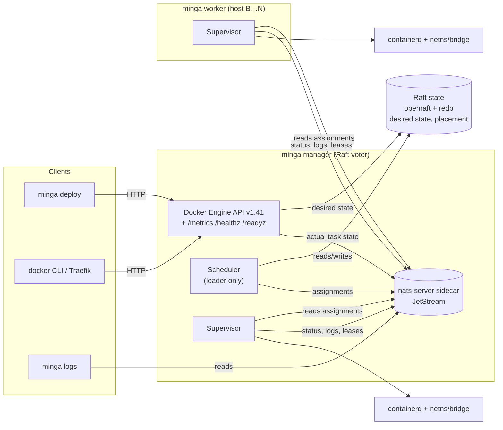
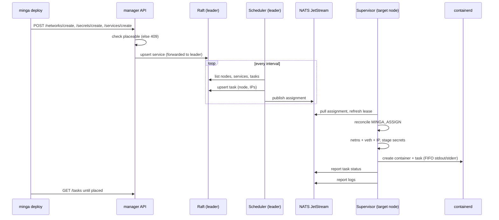
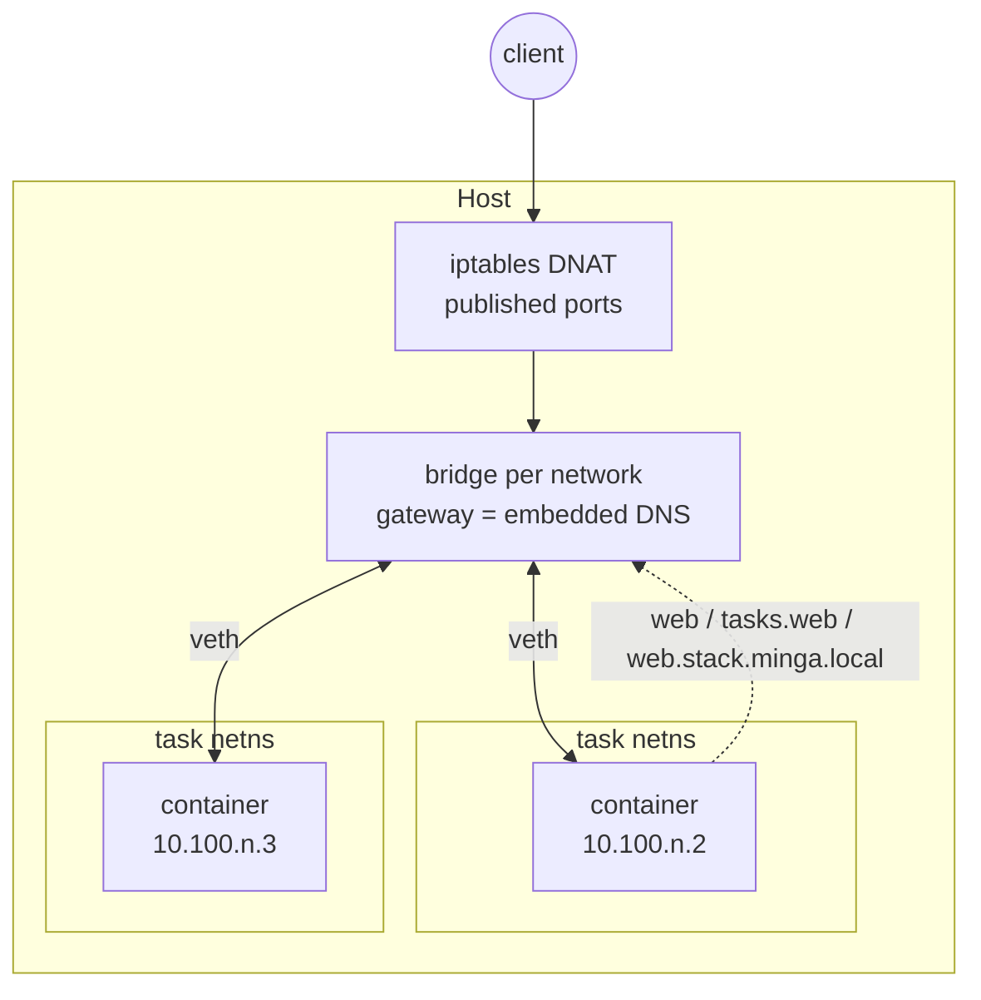
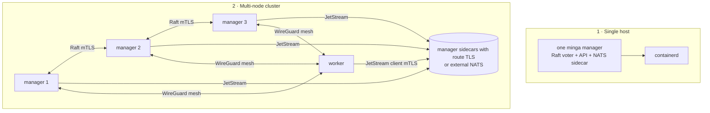

# Minga

[](LICENSE)
[](https://www.rust-lang.org)
[](CHANGELOG.md)

A single-binary container and agent orchestrator for **edge, on-prem and air-gapped sites**, written in Rust. It runs Compose files natively, speaks enough of the Docker Swarm API to replace it, and treats AI-agent workloads as first-class objects (WASM sandboxes and an LLM egress proxy today).

Named after the [minga](https://en.wikipedia.org/wiki/Minga) of Chiloé, where a community moves a whole house together.

> **Latest release: `v1.2.0`.** The release's capabilities and verification limits are in the [release notes](docs/release-1.2.0.md).
>
> **Current `main` is unreleased** ([`02c578c`](https://github.com/lithqube/minga/commit/02c578c22295ad88148ca696ed7ee755821e3148), PR [#103](https://github.com/lithqube/minga/pull/103)). It contains:
>
> - **Multi-node networking (Phase 13):** kernel WireGuard overlay, manager relay for NAT-isolated workers, cross-node ingress and same-network task isolation. T2/T3 live proofs passed; T4 scale has not been measured.
> - **Tenant isolation (Phase 15):** tenant-scoped API identities, resources, NATS permissions and quotas; worker enrollment binds nodes to tenants. T1–T5 implementation is merged. The end-to-end proof that tenant B cannot place on tenant A's node remains deferred until release readiness.
> - **Agent egress and usage (PR #103):** named tenant-owned routes, route/model policy, per-workload cache, streaming, per-run budgets, usage events and `minga-ctl agent usage`.
> - **Sandbox status:** Wasmtime fuel, epoch timeout and memory limits are enforced. Agent capability grants are parsed and validated, but WASI host imports are not linked yet; WASM guests cannot use env, files, clocks, stdio or HTTP egress. Firecracker remains a stub.
> - **Pre-release checks:** tenant-isolation proof, manager rejoin after NATS credential changes, and large-cluster scale measurement. VM tests remain deferred until release readiness.
>
> **Not in tagged `v1.2.0`:** cross-node WireGuard networking, tenant isolation, API client-certificate roles and audit. Those are current-main features, not part of the v1.2.0 release.
>
> Other current limits: no seccomp profile; Raft TLS without mTLS still warns rather than refusing off-loopback; API TLS/mTLS is available on current main, while `minga-ctl` does not yet support client-certificate credentials in its context.
>
> Details: [changelog](CHANGELOG.md), [release notes](docs/release-1.2.0.md), [architecture](docs/architecture.md), [supported topologies](docs/topologies.md), [CLI reference](docs/cli.md), [planning state](.planning/STATE.md).
>
> The Talos install is validated on a single docker-provisioned Talos v1.14 node, not on bare metal. FIPS, SOC 2, VS-NfD and NATO are **not assessed**, which is not the same as "not applicable".

## Why Minga

Docker Swarm is a fine orchestrator for a datacenter, but it was not built for the places Minga targets:

- **Edge sites** with a handful of ARM boards, intermittent connectivity, and no tolerance for a heavyweight control plane.
- **Air-gapped environments** where pulling images from a registry is not an option and every dependency must be vendored.
- **Agent workloads** that need sandboxed execution, token budgets and LLM egress control, not just "run a container".

Minga ships as **one binary** (plus the `nats-server` it supervises). There's no Docker daemon, no Kubernetes and no etcd. It reads a `compose.yaml` and runs it, with Raft for desired state and NATS/JetStream for status, logs and liveness.

## Features

- **Compose-native.** Full spec parsing with interpolation, profiles, merge keys and `x-` extensions. Unknown keys fail loudly with suggestions. `command`, `entrypoint`, `labels`, `healthcheck` (gates task readiness), volumes, bind mounts, placement constraints and `deploy.restart_policy` reach the container.
- **Swarm-compatible API.** Services, tasks, nodes, networks, secrets and configs, with label filters. `docker stack deploy`, `docker service ls`, `docker node ls` and Traefik v3's swarm provider work against the manager's API.
- **Raft consensus.** Desired state and placement go through [openraft](https://docs.rs/openraft), persisted in [redb](https://docs.rs/redb) as versioned JSON: a node refuses data it cannot read and says why, and fields added later need no wipe. mTLS on the Raft transport and bounded frames. No external etcd.
- **Backup and restore.** `minga state export` writes services, networks, volumes and secret and config references to a 0600 file; `minga state import` restores them into a fresh cluster, where the scheduler places the tasks again. [docs/backup.md](docs/backup.md) lists what else to copy.
- **Container networking:** deterministic per-task IPs from IPAM (each network gets its own /24 from `10.100.0.0/16`, or from `--overlay-supernet`, stored in Raft by the leader), one bridge per network, a netns and veth pair per task, embedded DNS (`<svc>`, `tasks.<svc>`, `<svc>.<stack>.minga.local`), and a node-level WireGuard mesh for cross-node traffic. Ingress ports answer on every node; `mode: host` stays node-local. Multi-manager clusters require reachable manager UDP endpoints; NAT workers relay through trusted managers. See [supported topologies](docs/topologies.md).
- **Secrets and logs.** Secrets are external references staged per task and content-addressed, so rotation never changes a running task's files. `minga logs [-f]` shows separated stdout/stderr from a JetStream-retained backlog.
- **Agent workloads.** `x-minga-agent` services run WASM modules under Wasmtime with fuel, interruptible timeouts and enforced memory limits. `x-minga-egress` configures named routes, route/model policy, per-workload caching, streaming and usage reporting for routed containers. Agent capability grants are validated but not yet linked to WASI imports, so a guest cannot access host I/O or the egress proxy. Per-run budgets are node-local; cross-node customer budgets and request-rate limits remain planned. Firecracker is a stub.
- **Observability.** `/metrics`, `/healthz` and `/readyz` on the manager API, and on manager and worker nodes via `--metrics-bind`. JSON logs on stderr for long-running roles. A failed container task keeps its last error and exit code, returned in the Docker API's task status and shown by `minga-ctl service ps` and `service inspect`; an agent task records the error only when it fails to start.
- **Air-gap friendly.** Release archives bundle a checksum-pinned `nats-server`, and `install.sh` verifies `SHA256SUMS`. A task pulls a missing image through containerd's Transfer API on the configured socket, with credentials from Docker credential helpers or inline `auths` that never appear on a command line; air-gapped sites preload images with `minga image pull` or `ctr` instead.

## Architecture

Every role is the same `minga` binary. A manager is a Raft voter and runs the scheduler, API and supervisor, and spawns `nats-server` as a child process. Workers run the supervisor only and connect to JetStream; they do not open Raft state.



> Only managers vote in Raft. Workers receive assignments and report status,
> logs and leases through JetStream; they never read or write Raft state.
> [docs/architecture.md](docs/architecture.md) describes the state boundaries.

### How a deploy becomes a running container



### Networking on one node



### Design principles

- **Rust on the hot path.** Per-packet, per-request and per-sandbox work stays in Rust. Go components (embedded NATS) run as separate processes; there's no FFI. See [ADR 0001](docs/adr/0001-language-split.md).
- **Only desired state and placement go through Raft.** Heartbeats, task status, agent run steps and node leases belong on JetStream ([ADR 0002](docs/adr/0002-event-bus-nats.md)).
- **Compose files deploy unchanged.** Unknown keys fail loudly instead of being skipped.
- **Simplicity over complexity.** One binary, and no external dependencies for consensus or storage.

## Crate layout

| Crate | Purpose |
| --- | --- |
| `minga-cli` | `minga` binary: manager/worker lifecycle, Compose validate/deploy, state export/import, logs, TLS/tenant enrollment utilities, networking, sandbox, agent, image and egress commands. |
| `minga-ctl` | Operator workstation CLI: contexts, stack/service operations, health, metrics, images/secrets/registry, and tenant-scoped agent usage queries. |
| `minga-compose` | Compose parser/validator, `x-minga-agent` and `x-minga-egress` extensions, interpolation, profiles, dependency and port checks. |
| `minga-state` | Raft desired state, tenant-owned entities, persisted formats/migrations, manager membership and state forwarding. |
| `minga-scheduler` | Compose translation, tenant-aware placement, IPAM, task/ingress/WireGuard projections and reconciliation. |
| `minga-api` | Docker Engine API subset, tenant/client identity and authorization, audit, quotas, manager/node enrollment and state translation. |
| `minga-node` | Manager/worker supervisor, containerd, netns/iptables, secret staging, Wasmtime agent execution and egress-proxy integration. |
| `minga-bus` | Memory and NATS/JetStream event bus, tenant-scoped subjects/keys, worker ACLs, usage and audit events. |
| `minga-net` | CIDR/IPAM, DNS records, node WireGuard interface/peer management and overlay routing. |
| `minga-sandbox` | Wasmtime runtime, shared engine/module cache, fuel, epoch interruption and memory limits; Firecracker stub. |
| `minga-egress` | Named-route proxy, destination policy, per-workload budgets/cache, streaming, usage accounting and secret redaction. |
| `minga-telemetry` | Prometheus metrics and `/metrics`, `/healthz`, `/readyz` endpoints with JSON logging. |

## Quick start: one Linux host

You need Linux, root (the supervisor creates netns, bridges and iptables rules), `iproute2` + `iptables` + `procps` (present in any standard server install; the container image bundles them), and containerd. A task pulls a missing image into the `minga` namespace through containerd's Transfer API on `--containerd-socket` (containerd 1.7 or newer for private registries). Registry credentials come from `$DOCKER_CONFIG/config.json`, else `~/.docker/config.json`: `credHelpers`, then `credsStore`, then inline `auths`.

```bash
# Installs minga + the checksum-pinned nats-server and verifies SHA256SUMS.
curl -fsSL https://github.com/lithqube/minga/releases/latest/download/install.sh | sh
# Same, plus the systemd unit and an /etc/minga/minga.env template:
#   curl -fsSL .../install.sh | sh -s -- --with-systemd
# Flags: --version vX.Y.Z, --prefix DIR, --uninstall (see install.sh --help).

# From source instead:
cargo build --release -p minga-cli
sudo install -m 0755 target/release/minga /usr/local/bin/minga

# Optional: preload images (air-gapped sites, private registries); otherwise a task pulls what it needs
sudo ctr -n minga images pull docker.io/library/nginx:1.27
```

Start one manager process. It is the Raft voter, scheduler, supervisor,
Docker Engine API and NATS sidecar:

```bash
sudo MINGA_API_TOKEN=change-me minga manager --node-id 1 \
  --bind 127.0.0.1:7001 --api-bind 127.0.0.1:2375 \
  --data-dir /var/lib/minga --runtime containerd --metrics-bind 127.0.0.1:9100
```

```bash
# Deploy, inspect, read logs
MINGA_API_TOKEN=change-me minga deploy -c compose.yaml shop
curl -s 127.0.0.1:9100/readyz
minga logs -f <task-id> --nats-url nats://127.0.0.1:4222
```

`minga validate -c compose.yaml` checks a Compose file offline and prints the startup order:

```
project plant-7
services in startup order:
  inference        registry.local/vllm:0.6.3                1 replica(s)
  agent-api        registry.local/agent-api:1.4.0           2 replica(s)  ports 443->8080/tcp  after inference
  sensors          registry.local/sensor-reader:2.1         global
  debug-ui         registry.local/debug-ui:latest           1 replica(s)  ports 9000->9000/tcp
```

**Agent workloads** (`x-minga-agent`) only run on nodes started with `--sandbox-runtime wasmtime`. Without it, the supervisor logs a warning and skips agent tasks. Stage each `.wasm` module on that node: a relative `module:` path resolves against `--module-dir` (default `/var/lib/minga/modules`), and an absolute path is used as is.

```bash
sudo minga manager … --sandbox-runtime wasmtime --module-dir /var/lib/minga/modules
```

For systemd, [`scripts/minga.service`](scripts/minga.service) runs either role from an environment file.

Every command and flag, the environment variables, and which deploy command to use: [docs/cli.md](docs/cli.md).

## Deployment topologies

Ports, what every node needs, what stays per node, and how far each layout is verified: [docs/topologies.md](docs/topologies.md).



1. **Single host.** One process and one Raft voter serve the API and run tasks.
   Containers reach each other by service name, and published ports work.
2. **Multi-node.** Only managers vote in Raft. Workers connect to JetStream and
   can join at runtime; managers can be added or removed through the API.
   Managers use clustered route-TLS sidecars or an external NATS cluster.
   Cross-node containers use the WireGuard mesh. Manager endpoints, relay
   trust, ingress/host publishing and verification status are in
   [supported topologies](docs/topologies.md).
3. **Talos Linux.** **Validated single-node install** on Talos v1.14: Minga runs as two `ContainerConfig` containers pulled from GHCR — no system extension, no custom boot asset — and workload images preload via a Kubernetes Job using the bundled `ctr`. Guide: [docs/talos-deployment.md](docs/talos-deployment.md). Bare-metal and multi-node are not hardware-validated.
4. **Air-gapped.** Copy the release archive (with `minga`, `nats-server` and the licenses) and image tarballs to the site. Then run `ctr -n minga images import <image>.tar` on each node and start the roles as above. No step needs a network connection.

### Container image

The release workflow also pushes a multi-arch image (`linux/amd64`, `linux/arm64`) built from the same binaries as the archives: `ghcr.io/lithqube/minga` with tags `vX.Y.Z`, `X.Y` and `latest`. The image bundles `nats-server` next to `minga`, like the archive.

```bash
docker run --rm ghcr.io/lithqube/minga:latest --help

# Manager on a host: node roles need the host network, NET_ADMIN and
# SYS_ADMIN (or --privileged), the containerd socket, and two path-identity
# mounts: the data dir (runc resolves minga's OCI bind sources on the host)
# and /run/netns with shared propagation (netns handles must be visible to
# runc outside the container).
docker run -d --name minga \
  --network host --cap-add NET_ADMIN --cap-add SYS_ADMIN \
  -v /run/containerd/containerd.sock:/run/containerd/containerd.sock \
  -v /var/lib/minga:/var/lib/minga \
  -v /run/netns:/var/run/netns:rshared \
  ghcr.io/lithqube/minga:latest \
  manager --node-id 1 --bind 127.0.0.1:7001 \
    --data-dir /var/lib/minga --runtime containerd --metrics-bind 127.0.0.1:9100
```

For systemd hosts the installer stays the better path; the image exists for container-first environments.

### Install targets

| Target | Path | Status |
|--------|------|--------|
| Talos v1.14+ | `scripts/setup-talos-minga.sh` ([guide](docs/talos-deployment.md)) | Validated on docker-provisioned Talos v1.14.5 through workload start (arm64); bare-metal pending |
| Debian 11/12, Ubuntu 20.04/22.04/24.04, Fedora 32+ | `install.sh [--with-systemd]` | Install, run, uninstall verified per distro in containers (arm64) |
| Container-first Linux | `ghcr.io/lithqube/minga` | Image verified (arm64) |
| Other glibc ≥ 2.31 Linux | `install.sh` or the tarball | Covered by the bullseye build floor; untested |
| macOS | Build from source (development only) | Not a deploy target |

x86_64 binaries are built by the same workflow but the on-machine verification above ran on arm64.

## Development

```bash
git clone https://github.com/lithqube/minga.git && cd minga
cargo build
cargo fmt --all
cargo clippy --all-targets -- -D warnings
cargo test --workspace          # bus tests need `nats-server` on PATH
cargo run -p minga-cli -- --help
```

Requirements: Rust 1.97+ with `rustfmt` and `clippy`, and `nats-server` for the bus suites. On Linux, the daemon-backed suites run with `sudo -E env "PATH=$PATH" MINGA_REQUIRE_CONTAINERD=1 cargo test -p minga-node --test containerd --test containerd_client`, which fails instead of skipping when containerd is missing. See [CONTRIBUTING.md](CONTRIBUTING.md).

## Roadmap

`v0.1.0` closed seven gates, each with an executable exit criterion ([docs/roadmap-v0.1.0.md](docs/roadmap-v0.1.0.md)):

- [x] Gate 1: cluster membership (self-registration, leases, 409 on unplaceable deploys)
- [x] Gate 2: `minga deploy` deploys through the shared API write path
- [x] Gate 3: container networking on a node (bridge, netns, DNAT, DNS)
- [x] Gate 4: Compose fidelity (Traefik v3 routes to a Minga service)
- [x] Gate 5: transport security and secrets (Raft mTLS, API token, NATS credentials, `minga tls`, secret staging)
- [x] Gate 6: real container logs
- [x] Gate 7: shippable (CI, release artifacts, `install.sh`, changelog)

Next, in order (rationale in [docs/architecture.md](docs/architecture.md)):

1. ~~Managers-only Raft: workers become pure JetStream clients, liveness moves to `MINGA_LEASES`, and nodes can join a running cluster.~~ Done.
2. ~~A multi-node WireGuard mesh on top of the per-node data plane.~~ Complete in Phase 13; T2/T3 live evidence and limits are documented.
3. ~~Registry credentials for image pull (an in-process pull that honors `--containerd-socket`).~~ Done in `v1.1.0`.
4. Tenant isolation ([ADR 0008](docs/adr/0008-multi-tenancy.md)): T1–T5 implementation is complete; tenant placement/isolation end-to-end proof remains a release-readiness gate.
5. Host capabilities for agent sandboxes: WASI, egress-only networking, host-injected workload identity, memory limits.

## Documentation

- [Architecture notes](docs/architecture.md): how the pieces fit today, known structural limits, and the plan
- [CLI reference](docs/cli.md): every `minga` and `minga-ctl` command, its flags and environment variables, and which deploy command to use
- [Supported topologies](docs/topologies.md): single host, from a workstation, air-gapped, Talos, container image and multi-node, with what each needs and how far it is verified
- [Resource benchmark](docs/benchmark.md): idle memory, CPU and process counts against Docker Compose and Swarm
- [Release notes: v1.2.0](docs/release-1.2.0.md)
- [Release notes: v1.1.0](docs/release-1.1.0.md)
- [Release notes: v1.0.2](docs/release-1.0.2.md)
- [Release notes: v1.0.1](docs/release-1.0.1.md)
- [Production-readiness plan](docs/production-readiness-plan.md): what single-node production needed after v1.0.2, and what is left
- [Backup and restore](docs/backup.md)
- [minga-ctl design plan](docs/minga-ctl-plan.md): the companion CLI and its trust model
- [Roadmap to v0.1.0](docs/roadmap-v0.1.0.md): the seven release gates and their evidence
- [ADR 0001: Language split](docs/adr/0001-language-split.md)
- [ADR 0002: Event bus](docs/adr/0002-event-bus-nats.md): NATS/JetStream behind `minga-bus`
- [ADR 0003: Agent workloads](docs/adr/0003-agent-workloads.md)
- [ADR 0004: Observability](docs/adr/0004-observability.md)
- [ADR 0005: API identity, roles and audit](docs/adr/0005-api-identity-and-roles.md) (Proposed)
- [Talos deployment guide](docs/talos-deployment.md) (validated on a single Talos v1.14 node, not bare metal)
- [NATS/JetStream evaluation](docs/research/nats-evaluation.md)
- [Design document](docs/design.md)
- [CLAUDE.md](CLAUDE.md): project conventions for AI-assisted development

## Contributing

Contributions are welcome. Please read [CONTRIBUTING.md](CONTRIBUTING.md) before opening a PR.

## License

[MIT](LICENSE). Copyright (c) 2026 Minga contributors. Release archives also contain `nats-server`, licensed under Apache 2.0 (`NATS-LICENSE`).
