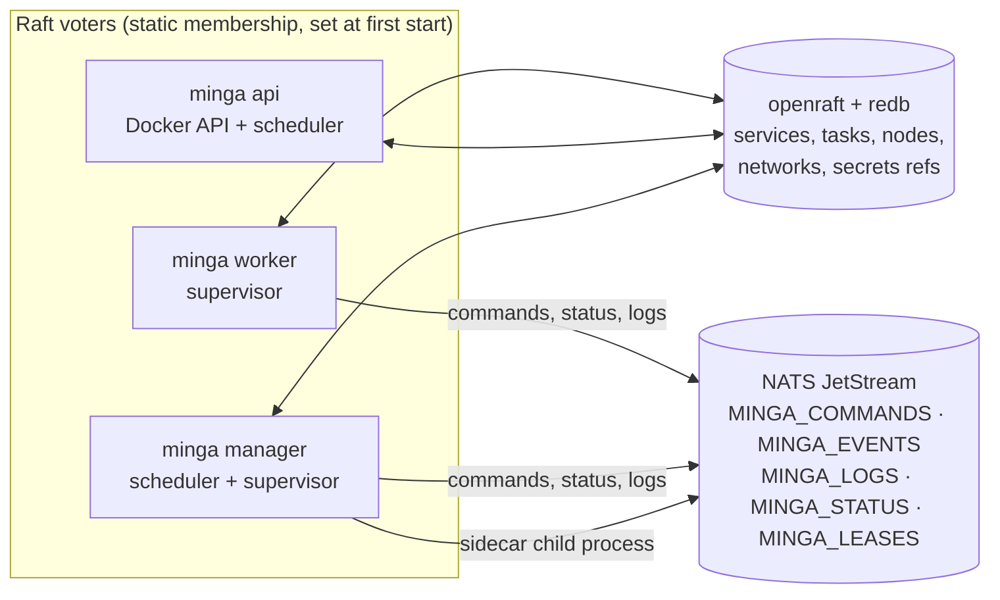
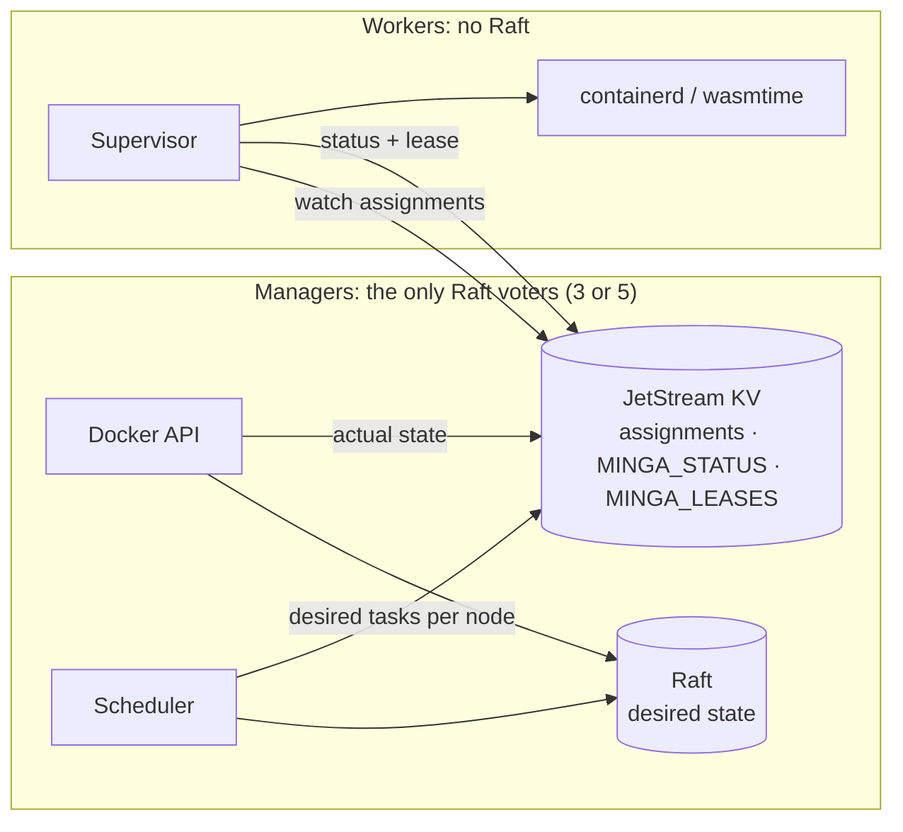

# Architecture notes

How Minga fits together **as of `v0.1.0` plus the Phase 0 fixes**, the structural limits that come with it, and the plan to remove them. Settled decisions live in the [ADRs](adr/); this page describes the code as it is.

## Processes and state

| Concern | Where it lives | Notes |
| --- | --- | --- |
| Desired state (services, networks, secret refs, configs) | Raft | Written through the Docker API (`minga deploy` uses it too). Writes are forwarded to the leader. |
| Placement (tasks with node and IPs) | Raft | The scheduler runs on whichever process is leader: a manager or `minga api`. |
| Task lifecycle (`running`/`stopped`) | Raft | Written by the supervisor so Docker API consumers (Traefik) see live state. |
| Node membership lease | Raft | `RenewNodeLease` every 10s, 30s TTL. One atomic command, so it can't undo a drain or recreate a removed node. |
| Assign/stop commands | JetStream work queue | Plus the supervisor's polling fallback against its local Raft replica (below). |
| Task status, logs, agent results | JetStream | `minga logs` reads the retained backlog. |
| Readiness | In-process | `/readyz`: a Raft leader is known, and on nodes the bus answers. |

## The deploy path

`minga deploy` translates Compose to state types, re-encodes them as Docker `ServiceSpec`s and posts them to `minga api`, which translates them back. Two translators (`minga-scheduler/src/translate.rs` and `minga-api/src/translate.rs`) must agree. Fields with no Docker equivalent ride in labels; for example, the agent spec travels as `minga.agent`. `deploy_e2e::deploy_keeps_restart_policy_and_agent_spec` guards the round trip.

## Known structural limits

These are deliberate `v0.1.0` trade-offs, listed so nobody builds on them by accident.

1. **Every node is a Raft voter.** Workers and `minga api` open a full `StateStore`, and membership is the `--peer` list at first start. Consequences:
   - Quorum depends on the number of workers, so flaky edge workers can stall deploys.
   - No node can join a running cluster.
   - A node started without `--peer` bootstraps its own one-node cluster.

   The 5,000-node target in ADR 0001 can't be reached this way.
2. **Liveness goes through Raft.** This breaks the "only desired state through Raft" rule, though the lease is now an atomic command. The lease is the node's wall clock compared with the leader's, so clock skew over 30s misjudges liveness. The bus lease (`refresh_lease`/`is_alive`) is maintained but placement doesn't use it.
3. **Two dispatch paths.** Workers start tasks from bus commands and by reconciling against their Raft replica. Bus-assigned tasks are exempt from Raft-driven stops, so a lost Stop command can orphan a container. `minga api`'s scheduler publishes no bus commands, so its tasks rely on the Raft path alone.
4. **Agent sandboxes have no host capabilities.** Modules are instantiated with zero imports: no WASI, network, env or clock. `memory_limit` and `token_budget` aren't enforced, and the egress proxy trusts a guest-supplied `X-Minga-Workload` header.
5. **No container networking across nodes.** Bridges, netns and DNAT are per host. WireGuard config is generated but never applied.

## Target shape

- Workers stop opening a `StateStore`. They watch a per-node assignment KV, report status, and keep a lease stamped by the server (not the node's clock).
- There's one dispatch path, and `minga api` folds into the manager process.
- Joining is a managers-only operation (`change_membership`). Existing clusters migrate by shrinking membership down to the managers.

This should be recorded as an ADR (Workers leave Raft) before any code moves. The runner-up is keeping workers in Raft as non-voting learners. It's cheaper, but every node would still replicate full state, and liveness would still go through Raft.

## Order of work

1. Tag `v0.1.0` with the Phase 0 fixes.
2. Image pull.
3. Managers-only Raft and worker join (limits 1–3).
4. WireGuard mesh (limit 5).
5. Spec-update reprovisioning and healthcheck enforcement.
6. Sandbox host capabilities: WASI with explicit grants, outbound HTTP only to the local egress proxy, host-injected workload identity, enforced memory limits (limit 4).
