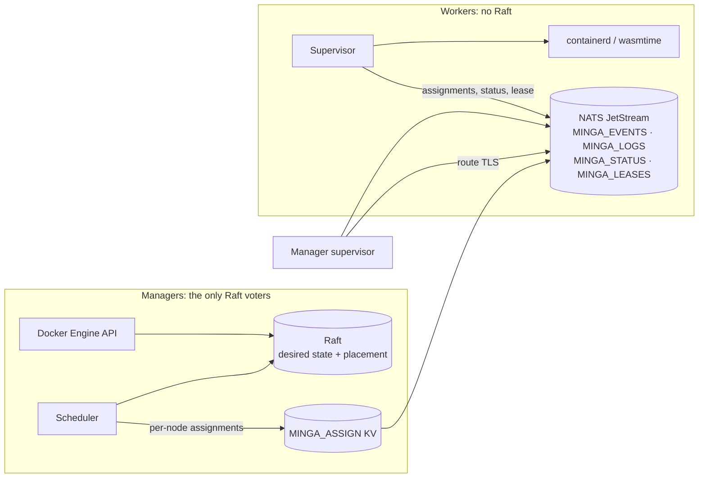
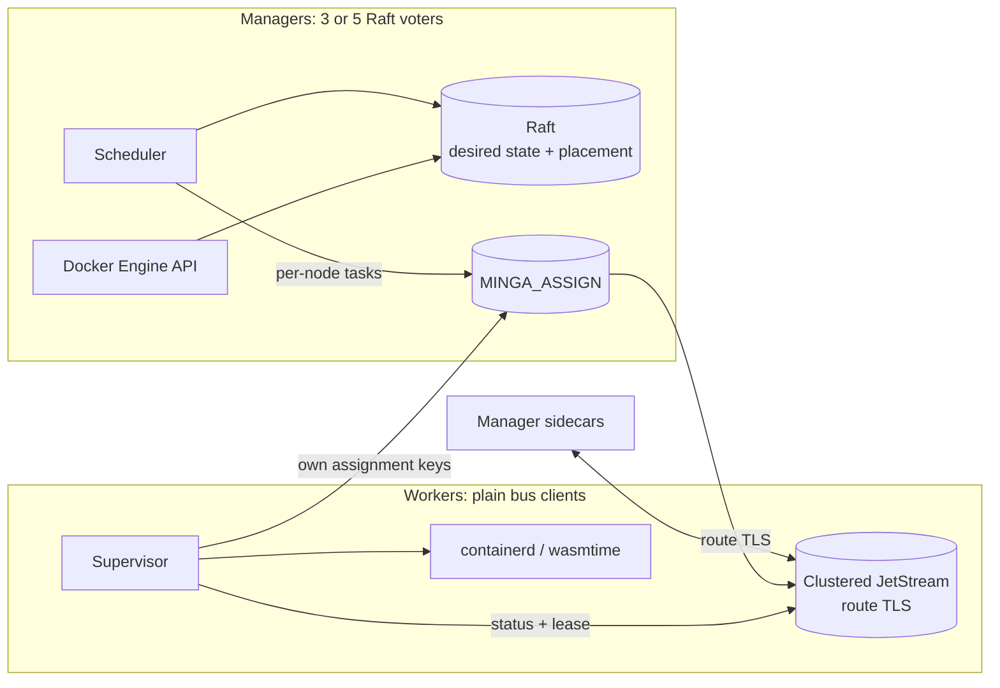

# Architecture notes

How Minga fits together **as of v1.2.0**, after Phase 12. Settled design decisions live in the [ADRs](adr/); this page describes the current code and the structural limits that remain.

## Processes and state

| Concern | Where it lives | Notes |
| --- | --- | --- |
| Desired state (services, networks, volumes, secret/config refs) | Raft | Written through the Docker Engine API; `minga deploy` uses the same path. Writes are forwarded to the leader. |
| Placement (tasks with node and IPs) | Raft | Only the elected manager leader schedules. |
| Task lifecycle and failure details | `MINGA_STATUS` JetStream KV | Supervisors write actual state; rollouts and Docker API task views combine it with Raft desired state. |
| Node liveness and registration | `MINGA_LEASES` JetStream KV | Server-stamped leases expire after 30 seconds. The leader registers first sightings in Raft without overwriting operator labels or availability. |
| Per-node task and network assignments | `MINGA_ASSIGN` JetStream KV | The leader projects placement; workers read only their own assignment keys. It is rebuilt from Raft after election. |
| Lifecycle events, logs and agent results | JetStream | `minga logs` reads the retained log backlog. `MINGA_LOGS` is single-replica; it is not HA storage. |
| Readiness | In-process | `/readyz` requires a known Raft leader and a responding bus. |

## Persisted format

Raft log entries, state-machine rows and Raft messages are JSON (`crates/minga-state/src/codec.rs`), and each redb file stores a one-byte `format_version` (currently 2). A new field marked `#[serde(default)]` needs nothing else, so state survives that upgrade. `Task.last_error` and `Task.last_exit_code` (why a task last ended) were added this way. Renaming, removing or re-typing a field, or changing what a value means, needs a version bump and a migration step. Frozen fixtures in `crates/minga-state/tests/fixtures/` fail the build when a persisted type changes shape, and a node refuses to open data it cannot read, saying why (data written by 1.0.2 or older: remove `raft_log.redb` and `state.redb` from `--data-dir`, not the whole directory).

The wire frame carries the format version but no schema revision, so nodes of one cluster must still run the same version: a node that does not know a new field drops it from the messages it relays. Upgrade every node together.

## The deploy path

`minga deploy` translates Compose to Docker `ServiceSpec`s and posts them to the Docker Engine API served by `minga manager`. The manager writes desired state through Raft; its scheduler projects per-node assignments into JetStream. Supervisors report actual task state to `MINGA_STATUS`. The Compose and Docker API translators must agree; `deploy_e2e::deploy_keeps_restart_policy_and_agent_spec` guards the round trip.

## Remaining structural limits

Phase 12 removes the worker-voter, Raft-liveness and dual-dispatch limits. Two
limits remain:

4. **Agent sandboxes have no host capabilities.** Modules are instantiated
   with zero imports: no WASI, network, env or clock. `memory_limit` and
   `token_budget` are not enforced. The egress proxy injects provider
   credentials itself (ADR 0003).
5. **No container networking across nodes.** Bridges, network namespaces and
   DNAT are per host. WireGuard configuration is generated but not applied;
   communicating services must stay on one node.

The target mesh design, including NAT relay trust and ingress publishing, is in
[ADR 0007: WireGuard Mesh and Routing Mesh](adr/0007-wireguard-mesh.md).

The T4 target of roughly 5,000 workers has not had a load test. The functional
architecture has no per-worker Raft replication or heartbeat writes.

## Managers-only Raft

- Only managers vote. Desired state, placement and manager membership go
  through Raft; task status, node leases and worker assignments go through
  JetStream.
- Workers have no Raft data directory or peer list. They watch only their own
  assignment keys and report status and server-expiring leases over mTLS.
- The manager process serves the Docker Engine API; there is no separate
  `minga api` process.
- Managers join and leave at runtime through the admin-token-protected
  membership API. A v1.2.0 migration removes worker voters while retaining
  services and desired state.

See [ADR 0006: Workers Leave Raft](adr/0006-workers-leave-raft.md) for the
settled decisions and [supported topologies](topologies.md) for T1–T4.

## Next work

1. WireGuard mesh and cross-node container networking.
2. Sandbox host capabilities: WASI with explicit grants, outbound HTTP only
   through the local egress proxy, host-injected workload identity and
   enforced memory limits.
Image pulls already use containerd’s Transfer service, read inline auth,
`credsStore` and `credHelpers`, and keep credentials off command lines.
