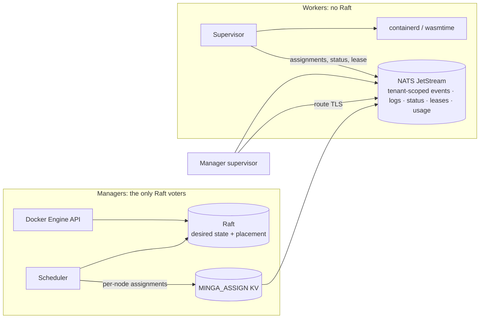
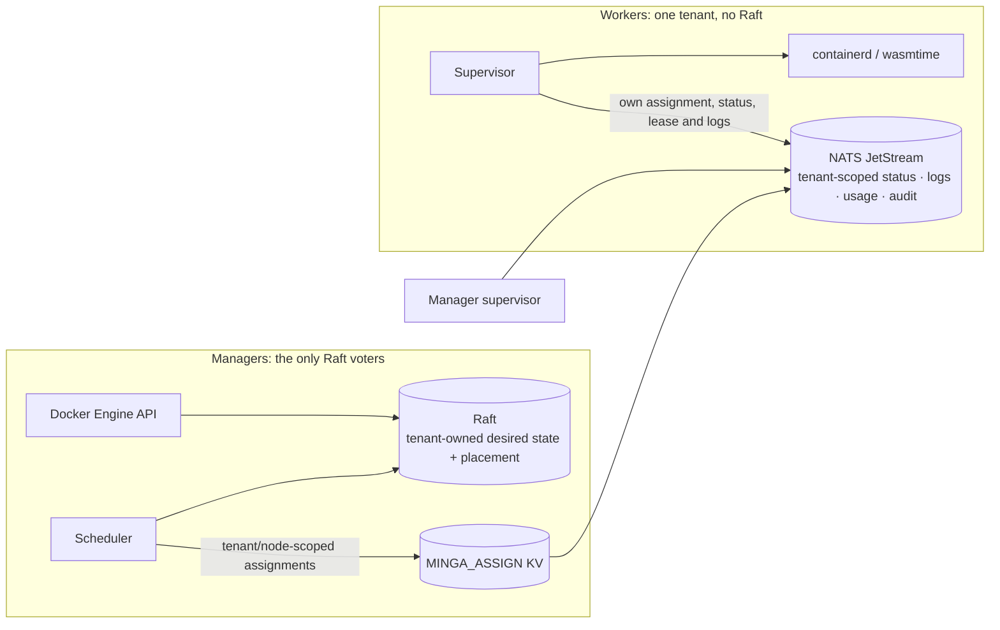

# Architecture notes

How Minga fits together in the current unreleased code after Phases 12–15. Settled design decisions live in the [ADRs](adr/); this page describes the current code and the structural limits that remain.

## Processes and state

| Concern | Where it lives | Notes |
| --- | --- | --- |
| Desired state (services, networks, volumes, secret/config refs) | Raft | Written through the Docker Engine API; `minga deploy` uses the same path. Writes are forwarded to the leader. |
| Placement (tasks with node and IPs) | Raft | Only the elected manager leader schedules. |
| Task lifecycle and failure details | `MINGA_STATUS` JetStream KV | Supervisors write actual state; rollouts and Docker API task views combine it with Raft desired state. |
| Node liveness and registration | `MINGA_LEASES` JetStream KV | Server-stamped leases expire after 30 seconds. The leader registers first sightings in Raft without overwriting operator labels or availability. |
| Per-node task and network assignments | `MINGA_ASSIGN` JetStream KV | The leader projects placement; workers read only their own assignment keys. It is rebuilt from Raft after election. |
| Tenant ownership and identity | Raft + API certificates | Tenant-owned resources are filtered before listing; workers use tenant-and-node-scoped NATS credentials. Cluster operators have cross-tenant administrative access, not workload access. |
| Egress and usage | Worker-local proxy + tenant JetStream streams | Route/model policies and per-workload budgets are enforced at the proxy; usage events and metrics omit prompts and response bodies. |
| Lifecycle events, logs and agent results | JetStream | `minga logs` reads the retained log backlog. `MINGA_LOGS` is single-replica; it is not HA storage. |
| Readiness | In-process | `/readyz` requires a known Raft leader and a responding bus. |

## Persisted format

Raft log entries, state-machine rows and Raft messages are JSON (`crates/minga-state/src/codec.rs`), and each redb file stores a one-byte `format_version` (currently 10). A new field marked `#[serde(default)]` needs nothing else, so state survives that upgrade. `Task.last_error` and `Task.last_exit_code` (why a task last ended) were added this way. Renaming, removing or re-typing a field, or changing what a value means, needs a version bump and a migration step. Frozen fixtures in `crates/minga-state/tests/fixtures/` fail the build when a persisted type changes shape, and a node refuses to open data it cannot read, saying why (data written by 1.0.2 or older: remove `raft_log.redb` and `state.redb` from `--data-dir`, not the whole directory).

The wire frame carries the format version but no schema revision, so nodes of one cluster must still run the same version: a node that does not know a new field drops it from the messages it relays. Upgrade every node together.

## The deploy path

`minga deploy` translates Compose to Docker `ServiceSpec`s and posts them to the Docker Engine API served by `minga manager`. The manager writes desired state through Raft; its scheduler projects per-node assignments into JetStream. Supervisors report actual task state to `MINGA_STATUS`. The Compose and Docker API translators must agree; `deploy_e2e::deploy_keeps_restart_policy_and_agent_spec` guards the round trip.

## Tenancy

Tenants are first-class desired state. Stacks, services, tasks, secrets,
configs, networks, volumes, routes and usage belong to one tenant. API client
certificates carry caller, role and tenant; cross-tenant object lookups return
404. A worker serves one tenant and can read/write only its tenant-and-node
bus subjects. In clusters with multiple tenants, managers do not run tenant
workloads. See [ADR 0008](adr/0008-multi-tenancy.md).

T1–T5 implementation is merged. T3's live end-to-end proof that one tenant
cannot place on another tenant's node remains a release-readiness gate; VM
tests stay deferred until that gate.

## Remaining structural limits

Phase 12 moves worker liveness, assignments and task status off Raft. Phase 13
implements the node-level WireGuard data plane, NAT relay and ingress mesh;
T2/T3 live proofs passed, including relay failover and bidirectional task HTTP.

1. **Agent WASI capabilities are not active.** Wasmtime enforces fuel,
   interruptible timeouts and memory limits. Compose capability grants and
   directory roots are persisted and validated, but no WASI linker or HTTP
   host function is installed; a guest cannot use those grants or reach the
   egress proxy. See the [sandbox plan](sandbox-host-capabilities-plan.md).
2. **Customer budgets are not cluster-wide.** The egress proxy has
   node-local per-workload budget tracking. Atomic per-tenant/service/customer
   window budgets and request-rate limits across nodes remain planned.
3. **T4 scale remains unmeasured.** The target is roughly 5,000 workers; no
   large-cluster load test has run.

Managers need reachable WireGuard endpoints in multi-manager clusters. When
both workers are behind NAT, a manager relays by decrypting and re-encrypting
packets, so it can inspect relayed container payloads. `MINGA_LOGS` remains
single-replica and is unavailable while its hosting NATS server is down.
After test credential updates, one manager failed to restart with an NATS
authorization violation; validate manager rejoin after credential changes
before release.

See [ADR 0007](adr/0007-wireguard-mesh.md) for mesh decisions and trust
boundaries, and [supported topologies](topologies.md) for evidence and
operational requirements.

## Managers-only Raft

- Only managers vote. Desired state, placement and manager membership go
  through Raft; task status, node leases, worker assignments and runtime
  events go through JetStream.
- Workers have no Raft data directory or peer list. Tenant-bound workers
  watch only their own assignment keys and report status and leases using
  tenant-and-node-scoped credentials.
- The manager serves the Docker Engine API; there is no separate
  `minga api` process.
- Managers join and leave through the authenticated membership API. Workers
  join a running cluster with a tenant-bound, 15-minute join token plus
  node-scoped NATS credentials.

See [ADR 0006](adr/0006-workers-leave-raft.md),
[ADR 0008](adr/0008-multi-tenancy.md) and
[supported topologies](topologies.md).

## Next work

1. At release readiness, run the deferred Phase 15 T3 tenant-isolation proof.
2. Before release, validate manager rejoin after NATS credential changes.
3. For agent-plane feature work, complete the remaining distributed customer
   budget and request-rate-limit work (B6/B7), then continue the listed
   identity, scheduled-job and sandbox-capability steps in
   [the agent-plane roadmap](agent-plane-roadmap.md).

Image pulls already use containerd’s Transfer service, read inline auth,
`credsStore` and `credHelpers`, and keep credentials off command lines.
