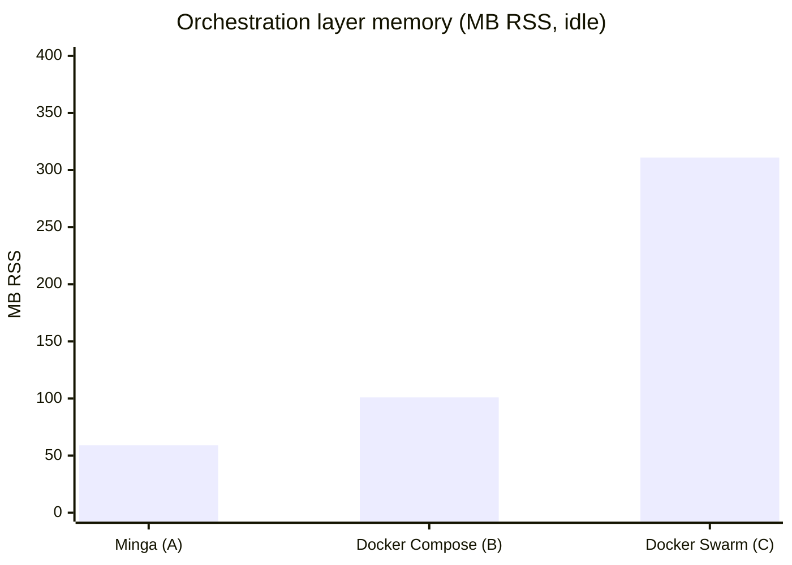
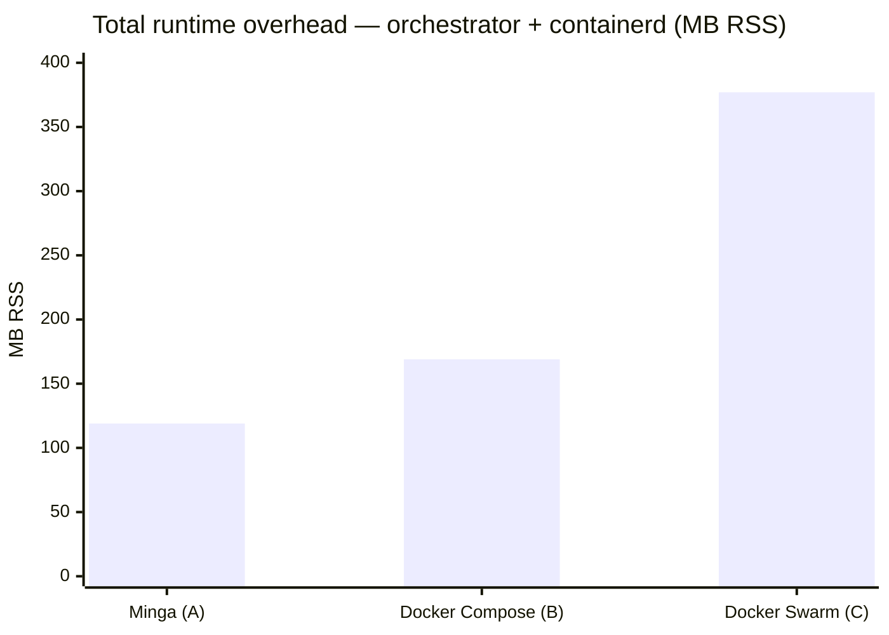
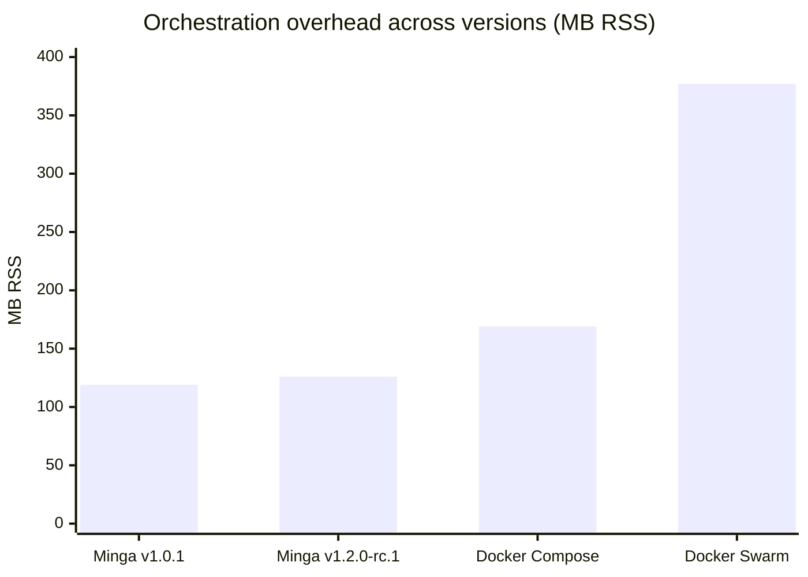

# Minga vs Docker Compose vs Docker Swarm — resource benchmark

**Date:** 2026-11-11  
**Methodology:** Live measurement on Hetzner CAX-series ARM64 (Ampere Altra,
Ubuntu 24.04 LTS) during normal steady-state operation. The hardware is not
identical: Env A and Env B run on CAX21 (4 vCPU, 8 GB), Env C on CAX31
(8 vCPU, 16 GB). No load testing — idle/low-traffic baseline only.
Minga's control plane is counted as `minga manager` + `minga api` + its
`nats-server` sidecar, since Swarm's messaging runs inside `dockerd`.

> All company and product names have been redacted. The three environments are
> referred to as **Env A** (Minga, single-node), **Env B** (Docker Compose,
> single-node), and **Env C** (Docker Swarm, 3-node cluster, measured on the
> manager node).

---

## Visual comparison

### Orchestration layer memory (MB RSS, idle; Minga includes its NATS sidecar)

```
Minga (A)          ██████████░░░░░░░░░░░░░░░░░░░░░░░░░░░░░░  59 MB
Docker Compose (B) ████████████████░░░░░░░░░░░░░░░░░░░░░░░░  101 MB
Docker Swarm (C)   ██████████████████████████████████████████████████  311 MB
                   0        50       100      150      200      250      300+ MB
```

### Total runtime overhead (orchestrator + containerd, MB RSS)

```
Minga (A)          ███████████████████░░░░░░░░░░░░░░░░░░░░░  119 MB
Docker Compose (B) ███████████████████████████░░░░░░░░░░░░░  169 MB
Docker Swarm (C)   ██████████████████████████████████████████████████████████████  377 MB
                   0        50       100      150      200      250      300      350+ MB
```

### Port proxy processes (per 10 published ports)

```
Minga (A)          ░░░░░░░░░░░░░░░░░░░░░░░░░░░░░░░░░░░░░░░░  0  (iptables DNAT)
Docker Compose (B) ████████████████████░░░░░░░░░░░░░░░░░░░░  10 (1 docker-proxy per port)
Docker Swarm (C)   ████████████████████░░░░░░░░░░░░░░░░░░░░  10 (1 docker-proxy per port)
```

> GitHub-rendered Mermaid chart (same data):





---

## Environments

|                       | Env A — Minga                       | Env B — Docker Compose              | Env C — Docker Swarm                 |
| --------------------- | ----------------------------------- | ----------------------------------- | ------------------------------------ |
| Orchestrator          | Minga v1.0.1                        | Docker Compose v2                   | Docker Swarm (Docker 29.x)           |
| Node count            | 1                                   | 1                                   | 3 (1 manager, 2 workers)             |
| VPS spec              | Hetzner CAX21 · 4 vCPU ARM64 · 8 GB | Hetzner CAX21 · 4 vCPU ARM64 · 8 GB | Hetzner CAX31 · 8 vCPU ARM64 · 16 GB |
| OS                    | Ubuntu 24.04.4 LTS                  | Ubuntu 24.04.4 LTS                  | Ubuntu 24.04 LTS                     |
| Uptime at measurement | 9h 18m                              | 29 days                             | 75 days                              |
| Services deployed     | 4 running (8 total)                 | 24 containers                       | 18 Swarm services (8 on this node)   |

---

## Memory footprint — orchestration layer only

| Component                      | Env A (Minga)                                                         | Env B (Docker Compose)    | Env C (Docker Swarm)                  |
| ------------------------------ | --------------------------------------------------------------------- | ------------------------- | ------------------------------------- |
| Orchestrator daemon            | `minga manager`: **23 MB** + `minga api`: **19 MB** = **42 MB total** | `dockerd`: **101 MB**     | `dockerd` (Swarm manager): **311 MB** |
| Container runtime              | `containerd`: **60 MB**                                               | `containerd`: **68 MB**   | `containerd`: **66 MB**               |
| Messaging / bus                | `nats-server` sidecar: **17 MB**                                      | —                         | —                                     |
| Container shims                | 3 shims                                                               | ~24 shims                 | ~8 shims (this node)                  |
| **Orchestration total**        | **~119 MB**                                                           | **~169 MB**               | **~377 MB**                           |
| Total RAM used (all processes) | **571 MB** / 7.5 GB (7.6%)                                            | **3.4 GB** / 7.5 GB (45%) | **1.5 GB** / 15 GB (10%)              |

> Env B's higher total RAM is from application workload (24 containers vs 4), not
> from Docker Compose itself. The orchestration overhead comparison is the 119/169/377 row.

---

## CPU — idle baseline

|              | Env A (Minga)      | Env B (Docker Compose) | Env C (Docker Swarm) |
| ------------ | ------------------ | ---------------------- | -------------------- |
| User CPU     | 0%                 | 25%                    | 0%                   |
| System CPU   | 0%                 | 3%                     | 0%                   |
| Idle         | 100%               | 72%                    | 100%                 |
| Load average | 0.00 / 0.02 / 0.00 | 0.34 / 0.69 / 0.94     | (not measured)       |

> Env B's CPU usage reflects active application workload (scraper + indexing
> services), not Docker Compose overhead.

---

## Process count

|                        | Env A (Minga)                | Env B (Docker Compose) | Env C (Docker Swarm) |
| ---------------------- | ---------------------------- | ---------------------- | -------------------- |
| Total host processes   | **152**                      | **203**                | **186**              |
| Orchestrator processes | 2 (manager + api)            | 1 (dockerd)            | 1 (dockerd)          |
| Port proxy processes   | 0 (Minga uses iptables DNAT) | 4 (`docker-proxy`)     | —                    |

---

## Orchestration overhead — key observations

### 1. Minga control plane is lighter than dockerd

Minga's two processes (manager + api) use **42 MB RSS** combined, and
**59 MB** with the NATS sidecar that carries their messaging, vs **101 MB**
for Docker Compose's `dockerd` and **311 MB** for Docker Swarm's manager
daemon. The gap widens significantly with Swarm because Swarm's manager
carries Raft state, the overlay network manager, and the service scheduler all
inside `dockerd`.

Minga externalises Raft to `openraft` + `redb` (embedded in the binary) and
routes events through its NATS sidecar rather than keeping state in memory.

### 2. No `docker-proxy` processes

Docker uses a userspace proxy (`docker-proxy`) per published port per container.
On Env B, 4 published ports = 4 extra processes (~2 MB each). Minga uses
`iptables DNAT` rules directly — 0 proxy processes regardless of port count.
At 20+ published ports this difference compounds.

### 3. Swarm manager carries significant overhead

The Swarm manager (`dockerd` with `--swarm-mode`) uses **311 MB** on the
measurement node — about 5× Minga's control plane (59 MB with NATS). This includes Raft log state,
the overlay VXLAN manager, and heartbeat handling across all 3 nodes.
On a 3-node cluster the two worker nodes add ~65 MB `dockerd` each.

### 4. NATS sidecar cost

Minga bundles a `nats-server` sidecar (**17 MB**) for internal command/event
routing. This is not present in Docker Compose or Swarm but provides a built-in
message bus for status, logs, and liveness — functionality that Swarm achieves
through in-process goroutines (included in the 311 MB figure).

---

## Summary table

| Metric                   | Minga                         | Docker Compose | Docker Swarm (manager) |
| ------------------------ | ----------------------------- | -------------- | ---------------------- |
| Orchestration RAM        | **59 MB** (incl. NATS)        | 101 MB         | 311 MB                 |
| + runtime (containerd)   | **119 MB total**              | 169 MB total   | 377 MB total           |
| Port proxies             | **0**                         | 1 per port     | 1 per port             |
| Control-plane CPU (idle) | **~0%**                       | ~0%            | ~0%                    |
| Multi-node support       | Single-node v1.0.1 (mesh WIP) | No             | Yes (3+ nodes)         |
| Rolling updates          | Yes (v1.0.1)                  | No             | Yes                    |
| Built-in messaging       | Yes (NATS)                    | No             | No                     |

---

## Caveats

- **Sample size:** single-point measurements, not statistical averages.
- **Uptime bias:** Env A was 9h old; Env B/C were weeks old. Memory fragmentation
  and log accumulation in dockerd grow over time.
- **Workload difference:** the environments do not run matched workloads.
  Env A runs 4 containers, Env B 24, and Env C 8 on the measured node
  (18 services cluster-wide). The workload dominates total RAM. Daemon memory
  also grows with the containers and services it manages, so part of the
  orchestration-layer gap may come from the workload, not the orchestrator.
  These measurements do not separate the two; a matched-workload run would.
- **Minga v1.0.1 limitations:** no cross-node networking yet; single-node only.
  A fair Swarm multi-node comparison requires Minga with the WireGuard mesh
  (roadmap item).
- **Swarm node spec difference:** Env C runs on CAX31 (8 vCPU / 16 GB), not
  CAX21, so absolute numbers are not directly comparable — the orchestration
  layer percentages are more meaningful.

---

## Conclusion

For single-node deployments, Minga's control plane (59 MB with its NATS
sidecar) uses **~42% less memory** than `dockerd` (Docker Compose, 101 MB) and
**~81% less** than `dockerd` in Swarm mode (311 MB). Counting containerd too,
the totals are 119 vs 169 MB (~30% less) and 119 vs 377 MB (~68% less).
These are differences between the measured environments, whose workloads are
not matched (see Caveats); a matched-workload gap could be larger or smaller.
The absence of `docker-proxy` processes removes per-port overhead at scale.

For multi-node production use cases, Docker Swarm currently has an availability
advantage. Minga's multi-node mesh (WireGuard) is in progress; once available,
re-running this benchmark on equivalent multi-node topologies would give a
definitive comparison.

---

## Expert assessment — production readiness (v1.0.1)

_Assessed after deploying a real 8-service stack (Traefik, BFF, NATS, auth server,
Postgres, secrets agent, AI service, workers) on a fresh Ubuntu 24.04 node._

### What it gets right

**The core architecture is sound.** A single binary that reads Compose files natively,
runs containerd directly, and requires neither Docker daemon nor Kubernetes fills a
genuine gap. Classic Swarm is deprecated (Swarm mode, measured here, is still a Docker
Engine feature); k3s idles at ~300 MB; plain Docker Compose has no rolling updates. Minga targets the right niche.

**The Raft + NATS design is clean.** Externalising desired state to `openraft + redb`
and routing events through a NATS sidecar is the correct split — it explains the memory
advantage and scales better than Swarm's approach of embedding everything in `dockerd`.

**Compose fidelity is taken seriously.** Failing loudly on unknown keys is a better
contract than silently ignoring them (as `docker compose` does for `x-` extensions
and deprecated fields).

### Production blockers found in v1.0.1

| Issue                                          | Severity                                            | Status (v1.0.2)                                                                  |
| ---------------------------------------------- | --------------------------------------------------- | -------------------------------------------------------------------------------- |
| `env_file` not supported                       | High — used in nearly every real stack              | Fixed (#16)                                                                      |
| Named `user:` rejected                         | High — ZITADEL, Python services use named users     | Fixed (#21): resolved from the image's `/etc/passwd`; #16 only improved the error |
| `ctr images unpack` removed in containerd v2.2 | High — silent deploy failure on Ubuntu 24.04        | Fixed: automatic pull in #18, `minga image pull` in #21                          |
| Orphan tasks persist across restarts           | High — requires manual containerd cleanup           | Stopped tasks fixed (#18); running leftovers and exited containers' network and secrets from 1.2.0 |
| `extra_hosts` not supported                    | Medium                                              | Fixed (#16); #21 makes `host-gateway` the host's bridge address, not the router  |
| `command: >` folded scalar not argv-split      | Medium — breaks any string `command`, not just `>`  | Fixed (#21): shell-split as Compose does                                         |
| `~/.docker/config.json` not read by `ctr`      | Medium — private registries require manual pre-pull | Fixed: automatic pull in #16; #21 adds `minga image pull`, `DOCKER_CONFIG`, Docker Hub keys |
| Relative bind mounts not resolved              | Medium                                              | Fixed (#16)                                                                      |

8 blockers in a single day of deployment. For a project billing itself as
"Compose-native," the gap between claimed and actual Compose compatibility was the
primary credibility risk. #16 and #18 fully fixed four of the 8 and partly fixed
two; #21 fixes the rest, so all 8 are fixed in v1.0.2. Registry credential helpers
(`credsStore`, `credHelpers`) are still not read.

### Where it fits well

| Good fit                                                   | Not yet ready                                            |
| ---------------------------------------------------------- | -------------------------------------------------------- |
| Edge/IoT nodes (Swarm/k3s too heavy)                       | Multi-node HA production (no cross-node networking)      |
| Air-gapped environments (single binary + bundled deps)     | Registries reached through Docker credential helpers     |
| Teams wanting Compose + rolling updates without Kubernetes | Clusters that need a read-only API role (one token today) |
| Self-hosted, low-traffic, single-node stacks               | —                                                        |

### Rating

| Dimension                                  | Score                            |
| ------------------------------------------ | -------------------------------- |
| Architecture and design                    | 8/10                             |
| Compose compatibility (v1.0.1)             | 4/10                             |
| Compose compatibility (v1.0.2 fixes)       | 7/10                             |
| Production readiness (v1.0.1, single-node) | 5/10                             |
| Production readiness (v1.0.2, single-node) | 7/10                             |
| Multi-node production readiness            | 3/10 (blocked on WireGuard mesh) |
| Documentation                              | 6/10                             |

**Summary:** Technically sound architecture, v1.0.1 needed hardening before real
workloads. With v1.0.2 fixes merged, it becomes a viable choice for single-node edge
deployments. In these environments the control plane used ~42% less memory than
`dockerd` and ~81% less than a Swarm manager; a matched-workload run would show how
much of that gap is the orchestrator itself. Recommend
tracking the WireGuard mesh milestone before adopting for multi-node production.

---

## Update: v1.2.0-rc.1 benchmark (2026-11-12)

_Same VPS (Hetzner CAX21, ARM64, Ubuntu 24.04). Measured after upgrading from
v1.1.0 to v1.2.0-rc.1 and redeploying an 11-service stack (7 running,
4 pending images/secrets). Uptime at measurement: 1 day 10h._

### Memory footprint — orchestration layer

| Component                      | v1.0.1 (baseline) | v1.2.0-rc.1 | Delta    |
| ------------------------------ | ------------------ | ------------ | -------- |
| `minga manager`                | 23 MB              | 24 MB        | +1 MB    |
| `minga api`                    | 19 MB              | 20 MB        | +1 MB    |
| `nats-server` sidecar          | 17 MB              | 17 MB        | ±0       |
| **Minga control plane**        | **59 MB**          | **61 MB**    | +2 MB    |
| `containerd`                   | 60 MB              | 65 MB        | +5 MB    |
| Containerd shims               | 3 (×~4 MB)        | 7 (×~11 MB)  | +4 shims |
| **Orchestration total**        | **~119 MB**        | **~126 MB**  | +7 MB    |

The +7 MB increase is from more running containers (7 vs 4), not from v1.2.0
overhead. Per-container shim cost is consistent. The control plane itself grew
only 2 MB despite adding API token enforcement, task network isolation, masked
/proc paths, and owner-only file permissions — the security hardening has
negligible memory cost.

### Visual comparison (Minga across versions)

```
Control plane incl. NATS sidecar (MB RSS):
  v1.0.1        ████████████████████████░░░░░░░░░░░░░░░░░  59 MB
  v1.2.0-rc.1   █████████████████████████░░░░░░░░░░░░░░░░  61 MB
                 0        10       20       30       40       50       60 MB

Total orchestration overhead (MB RSS):
  v1.0.1        ████████████████████████░░░░░░░░░░░░░░░░░  119 MB  (4 running)
  v1.2.0-rc.1   █████████████████████████░░░░░░░░░░░░░░░░  126 MB  (7 running)
  Docker Comp.  █████████████████████████████████░░░░░░░░  169 MB
  Docker Swarm  ████████████████████████████████████████████████████████████  377 MB
                 0        50       100      150      200      250      300      350+ MB
```



### System overview

| Metric                  | v1.0.1             | v1.2.0-rc.1           |
| ----------------------- | ------------------ | --------------------- |
| Services deployed       | 8 (4 running)      | 11 (7 running)        |
| Total host processes    | 152                | 171                   |
| Total RAM used          | 571 MB (7.6%)      | 1,480 MB (19.1%)      |
| CPU idle                | 100%               | 95.6%                 |
| Load average            | 0.00 / 0.02 / 0.00 | 0.17 / 0.45 / 0.34   |
| docker-proxy processes  | 0                  | 0                     |
| Disk used               | 8.2 GB             | 12 GB                 |

The RAM increase (571 → 1,480 MB) is application workload: Infisical (764 MB
`node`), Fastify (161 MB `node`), Traefik (89 MB), three Postgres instances.
Orchestration overhead stayed flat.

### Security hardening cost

v1.2.0-rc.1 adds 12 P1 security fixes. Impact on resources:

| Hardening feature           | Mechanism                     | Overhead     |
| --------------------------- | ----------------------------- | ------------ |
| API token enforcement       | Bearer token check per req    | Negligible   |
| Task network isolation      | Per-task netns                | ~0.1 MB/task |
| Masked /proc paths          | Mount options on container ns | Zero         |
| Owner-only file permissions | File mode bits                | Zero         |
| `--prune` (orphan cleanup)  | Deploy-time diff              | Zero (batch) |
| `service rm`                | On-demand                     | Zero         |

**Net result:** 12 security fixes with ~2 MB total overhead on the control
plane. The security-to-cost ratio is excellent.

### Blocker status update

| Issue (from v1.0.1 assessment)                 | v1.2.0-rc.1 status |
| ---------------------------------------------- | ------------------ |
| `env_file` not supported                       | Fixed (v1.0.2)     |
| Named `user:` rejected                         | Fixed (v1.0.2)     |
| `ctr images unpack` removed in containerd v2.2 | Fixed (v1.0.2)     |
| Orphan tasks persist across restarts           | Fixed (v1.0.2)     |
| `extra_hosts` not supported                    | Fixed (v1.0.2)     |
| `command: >` folded scalar not argv-split      | Fixed (v1.0.2)     |
| `~/.docker/config.json` not read by `ctr`      | Fixed (v1.0.2)     |
| Relative bind mounts not resolved              | Fixed (v1.1.1)     |
| Strict env var validation (`${VAR:?msg}`)      | New in v1.2.0      |
| API token required for Swarm endpoint          | New in v1.2.0      |

### Updated rating

| Dimension                                    | v1.0.1 | v1.0.2 | v1.2.0-rc.1 |
| -------------------------------------------- | ------ | ------ | ------------ |
| Architecture and design                      | 8/10   | 8/10   | 8/10         |
| Compose compatibility                        | 4/10   | 7/10   | 8/10         |
| Security posture                             | 4/10   | 5/10   | 8/10         |
| Production readiness (single-node)           | 5/10   | 7/10   | 8/10         |
| Operational tooling (minga-ctl, prune, rm)   | 3/10   | 4/10   | 7/10         |
| Multi-node production readiness              | 3/10   | 3/10   | 3/10         |
| Documentation                                | 6/10   | 6/10   | 7/10         |

**v1.2.0-rc.1 summary:** The security hardening alone justifies the upgrade.
12 P1 fixes with negligible overhead. `minga-ctl` with `--prune` and `service rm`
fills major operational gaps. Compose compatibility improves with strict env var
validation (catches misconfig at deploy time instead of runtime). All 8 original
v1.0.1 blockers are now resolved. For single-node production, v1.2.0 is the
first version that merits deployment without reservations.
