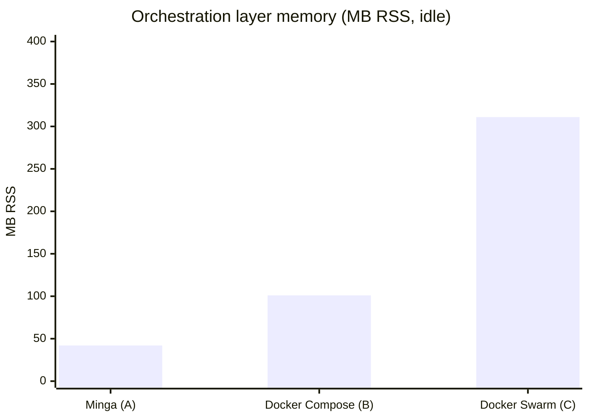
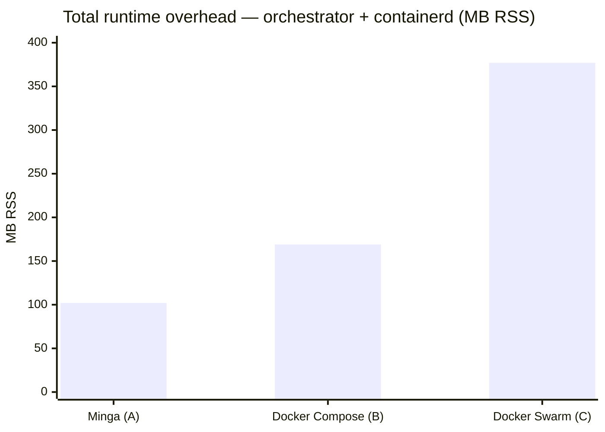

# Minga vs Docker Compose vs Docker Swarm — resource benchmark

**Date:** 2026-11-11  
**Methodology:** Live measurement on identical ARM64 hardware (Hetzner CAX series,
Ubuntu 24.04 LTS, Ampere Altra) during normal steady-state operation.
No load testing — idle/low-traffic baseline only.

> All company and product names have been redacted. The three environments are
> referred to as **Env A** (Minga, single-node), **Env B** (Docker Compose,
> single-node), and **Env C** (Docker Swarm, 3-node cluster, measured on the
> manager node).

---

## Visual comparison

### Orchestration layer memory (MB RSS, idle)

```
Minga (A)          ██████░░░░░░░░░░░░░░░░░░░░░░░░░░░░░░░░░░  42 MB
Docker Compose (B) ████████████████░░░░░░░░░░░░░░░░░░░░░░░░  101 MB
Docker Swarm (C)   ██████████████████████████████████████████████████  311 MB
                   0        50       100      150      200      250      300+ MB
```

### Total runtime overhead (orchestrator + containerd, MB RSS)

```
Minga (A)          ████████████████░░░░░░░░░░░░░░░░░░░░░░░░  102 MB
Docker Compose (B) ███████████████████████████░░░░░░░░░░░░░  169 MB
Docker Swarm (C)   ██████████████████████████████████████████████████████████████  377 MB
                   0        50       100      150      200      250      300      350+ MB
```

### Port proxy processes (per 10 published ports)

```
Minga (A)          ░░░░░░░░░░░░░░░░░░░░░░░░░░░░░░░░░░░░░░░░  0  (iptables DNAT)
Docker Compose (B) ████████████████████░░░░░░░░░░░░░░░░░░░░  10 (1 docker-proxy per port)
Docker Swarm (C)   ████████████████████░░░░░░░░░░░░░░░░░░░░  10 (1 docker-proxy per port)
```

> GitHub-rendered Mermaid chart (same data):





---

## Environments

|                       | Env A — Minga                       | Env B — Docker Compose              | Env C — Docker Swarm                 |
| --------------------- | ----------------------------------- | ----------------------------------- | ------------------------------------ |
| Orchestrator          | Minga v1.0.1                        | Docker Compose v2                   | Docker Swarm (Docker 29.x)           |
| Node count            | 1                                   | 1                                   | 3 (1 manager, 2 workers)             |
| VPS spec              | Hetzner CAX21 · 4 vCPU ARM64 · 8 GB | Hetzner CAX21 · 4 vCPU ARM64 · 8 GB | Hetzner CAX31 · 8 vCPU ARM64 · 16 GB |
| OS                    | Ubuntu 24.04.4 LTS                  | Ubuntu 24.04.4 LTS                  | Ubuntu 24.04 LTS                     |
| Uptime at measurement | 9h 18m                              | 29 days                             | 75 days                              |
| Services deployed     | 4 running (8 total)                 | 24 containers                       | 18 Swarm services (8 on this node)   |

---

## Memory footprint — orchestration layer only

| Component                      | Env A (Minga)                                                         | Env B (Docker Compose)    | Env C (Docker Swarm)                  |
| ------------------------------ | --------------------------------------------------------------------- | ------------------------- | ------------------------------------- |
| Orchestrator daemon            | `minga manager`: **23 MB** + `minga api`: **19 MB** = **42 MB total** | `dockerd`: **101 MB**     | `dockerd` (Swarm manager): **311 MB** |
| Container runtime              | `containerd`: **60 MB**                                               | `containerd`: **68 MB**   | `containerd`: **66 MB**               |
| Messaging / bus                | `nats-server` sidecar: **17 MB**                                      | —                         | —                                     |
| Container shims                | 3 shims                                                               | ~24 shims                 | ~8 shims (this node)                  |
| **Orchestration total**        | **~119 MB**                                                           | **~169 MB**               | **~377 MB**                           |
| Total RAM used (all processes) | **571 MB** / 7.5 GB (7.6%)                                            | **3.4 GB** / 7.5 GB (45%) | **1.5 GB** / 15 GB (10%)              |

> Env B's higher total RAM is from application workload (24 containers vs 4), not
> from Docker Compose itself. The orchestration overhead comparison is the 119/169/377 row.

---

## CPU — idle baseline

|              | Env A (Minga)      | Env B (Docker Compose) | Env C (Docker Swarm) |
| ------------ | ------------------ | ---------------------- | -------------------- |
| User CPU     | 0%                 | 25%                    | 0%                   |
| System CPU   | 0%                 | 3%                     | 0%                   |
| Idle         | 100%               | 72%                    | 100%                 |
| Load average | 0.00 / 0.02 / 0.00 | 0.34 / 0.69 / 0.94     | (not measured)       |

> Env B's CPU usage reflects active application workload (scraper + indexing
> services), not Docker Compose overhead.

---

## Process count

|                        | Env A (Minga)                | Env B (Docker Compose) | Env C (Docker Swarm) |
| ---------------------- | ---------------------------- | ---------------------- | -------------------- |
| Total host processes   | **152**                      | **203**                | **186**              |
| Orchestrator processes | 2 (manager + api)            | 1 (dockerd)            | 1 (dockerd)          |
| Port proxy processes   | 0 (Minga uses iptables DNAT) | 4 (`docker-proxy`)     | —                    |

---

## Orchestration overhead — key observations

### 1. Minga control plane is lighter than dockerd

Minga's two-process design (manager + api) uses **42 MB RSS** combined, vs
**101 MB** for Docker Compose's `dockerd` and **311 MB** for Docker Swarm's
manager daemon. The gap widens significantly with Swarm because Swarm's manager
carries Raft state, the overlay network manager, and the service scheduler all
inside `dockerd`.

Minga externalises Raft to `openraft` + `redb` (embedded in the binary) and
routes events through its NATS sidecar rather than keeping state in memory.

### 2. No `docker-proxy` processes

Docker uses a userspace proxy (`docker-proxy`) per published port per container.
On Env B, 4 published ports = 4 extra processes (~2 MB each). Minga uses
`iptables DNAT` rules directly — 0 proxy processes regardless of port count.
At 20+ published ports this difference compounds.

### 3. Swarm manager carries significant overhead

The Swarm manager (`dockerd` with `--swarm-mode`) uses **311 MB** on the
measurement node — 7× Minga's control plane. This includes Raft log state,
the overlay VXLAN manager, and heartbeat handling across all 3 nodes.
On a 3-node cluster the two worker nodes add ~65 MB `dockerd` each.

### 4. NATS sidecar cost

Minga bundles a `nats-server` sidecar (**17 MB**) for internal command/event
routing. This is not present in Docker Compose or Swarm but provides a built-in
message bus for status, logs, and liveness — functionality that Swarm achieves
through in-process goroutines (included in the 311 MB figure).

---

## Summary table

| Metric                   | Minga                         | Docker Compose | Docker Swarm (manager) |
| ------------------------ | ----------------------------- | -------------- | ---------------------- |
| Orchestration RAM        | **42 MB**                     | 101 MB         | 311 MB                 |
| + runtime (containerd)   | **102 MB total**              | 169 MB total   | 377 MB total           |
| Port proxies             | **0**                         | 1 per port     | 1 per port             |
| Control-plane CPU (idle) | **~0%**                       | ~0%            | ~0%                    |
| Multi-node support       | Single-node v1.0.1 (mesh WIP) | No             | Yes (3+ nodes)         |
| Rolling updates          | Yes (v1.0.1)                  | No             | Yes                    |
| Built-in messaging       | Yes (NATS)                    | No             | No                     |

---

## Caveats

- **Sample size:** single-point measurements, not statistical averages.
- **Uptime bias:** Env A was 9h old; Env B/C were weeks old. Memory fragmentation
  and log accumulation in dockerd grow over time.
- **Workload difference:** Env B runs more containers (24 vs 4), which dominates
  total RAM numbers but not orchestration-layer numbers.
- **Minga v1.0.1 limitations:** no cross-node networking yet; single-node only.
  A fair Swarm multi-node comparison requires Minga with the WireGuard mesh
  (roadmap item).
- **Swarm node spec difference:** Env C runs on CAX31 (8 vCPU / 16 GB), not
  CAX21, so absolute numbers are not directly comparable — the orchestration
  layer percentages are more meaningful.

---

## Conclusion

For single-node deployments, Minga's control plane uses **~60% less memory**
than `dockerd` (Docker Compose) and **~73% less** than `dockerd` in Swarm mode.
The absence of `docker-proxy` processes removes per-port overhead at scale.

For multi-node production use cases, Docker Swarm currently has an availability
advantage. Minga's multi-node mesh (WireGuard) is in progress; once available,
re-running this benchmark on equivalent multi-node topologies would give a
definitive comparison.

---

## Expert assessment — production readiness (v1.0.1)

_Assessed after deploying a real 8-service stack (Traefik, BFF, NATS, auth server,
Postgres, secrets agent, AI service, workers) on a fresh Ubuntu 24.04 node._

### What it gets right

**The core architecture is sound.** A single binary that reads Compose files natively,
runs containerd directly, and requires neither Docker daemon nor Kubernetes fills a
genuine gap. Swarm is deprecated; k3s idles at ~300 MB; plain Docker Compose has no
rolling updates. Minga targets the right niche.

**The Raft + NATS design is clean.** Externalising desired state to `openraft + redb`
and routing events through a NATS sidecar is the correct split — it explains the memory
advantage and scales better than Swarm's approach of embedding everything in `dockerd`.

**Compose fidelity is taken seriously.** Failing loudly on unknown keys is a better
contract than silently ignoring them (as `docker compose` does for `x-` extensions
and deprecated fields).

### Production blockers found in v1.0.1

| Issue                                          | Severity                                            | Status          |
| ---------------------------------------------- | --------------------------------------------------- | --------------- |
| `env_file` not supported                       | High — used in nearly every real stack              | Fixed in v1.0.2 |
| Named `user:` rejected                         | High — ZITADEL, Python services use named users     | Fixed in v1.0.2 |
| `ctr images unpack` removed in containerd v2.2 | High — silent deploy failure on Ubuntu 24.04        | Fixed in v1.0.2 |
| Orphan tasks persist across restarts           | High — requires manual containerd cleanup           | Fixed in v1.0.2 |
| `extra_hosts` not supported                    | Medium                                              | Fixed in v1.0.2 |
| `command: >` folded scalar not argv-split      | Medium — breaks multi-line commands                 | Open            |
| `~/.docker/config.json` not read by `ctr`      | Medium — private registries require manual pre-pull | Fixed in v1.0.2 |
| Relative bind mounts not resolved              | Medium                                              | Fixed in v1.0.2 |

8 blockers in a single day of deployment. For a project billing itself as
"Compose-native," the gap between claimed and actual Compose compatibility was the
primary credibility risk. 6 of the 8 are fixed in v1.0.2.

### Where it fits well

| Good fit                                                   | Not yet ready                                            |
| ---------------------------------------------------------- | -------------------------------------------------------- |
| Edge/IoT nodes (Swarm/k3s too heavy)                       | Multi-node HA production (no cross-node networking)      |
| Air-gapped environments (single binary + bundled deps)     | Orgs with private registries and existing Docker tooling |
| Teams wanting Compose + rolling updates without Kubernetes | Services with complex `command: >` multi-line args       |
| Self-hosted, low-traffic, single-node stacks               | —                                                        |

### Rating

| Dimension                                  | Score                            |
| ------------------------------------------ | -------------------------------- |
| Architecture and design                    | 8/10                             |
| Compose compatibility (v1.0.1)             | 4/10                             |
| Compose compatibility (v1.0.2 fixes)       | 7/10                             |
| Production readiness (v1.0.1, single-node) | 5/10                             |
| Production readiness (v1.0.2, single-node) | 7/10                             |
| Multi-node production readiness            | 3/10 (blocked on WireGuard mesh) |
| Documentation                              | 6/10                             |

**Summary:** Technically sound architecture, v1.0.1 needed hardening before real
workloads. With v1.0.2 fixes merged, it becomes a viable choice for single-node edge
deployments. The 60–73% memory advantage over Docker/Swarm is real. Recommend
tracking the WireGuard mesh milestone before adopting for multi-node production.
