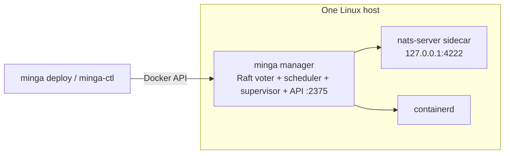
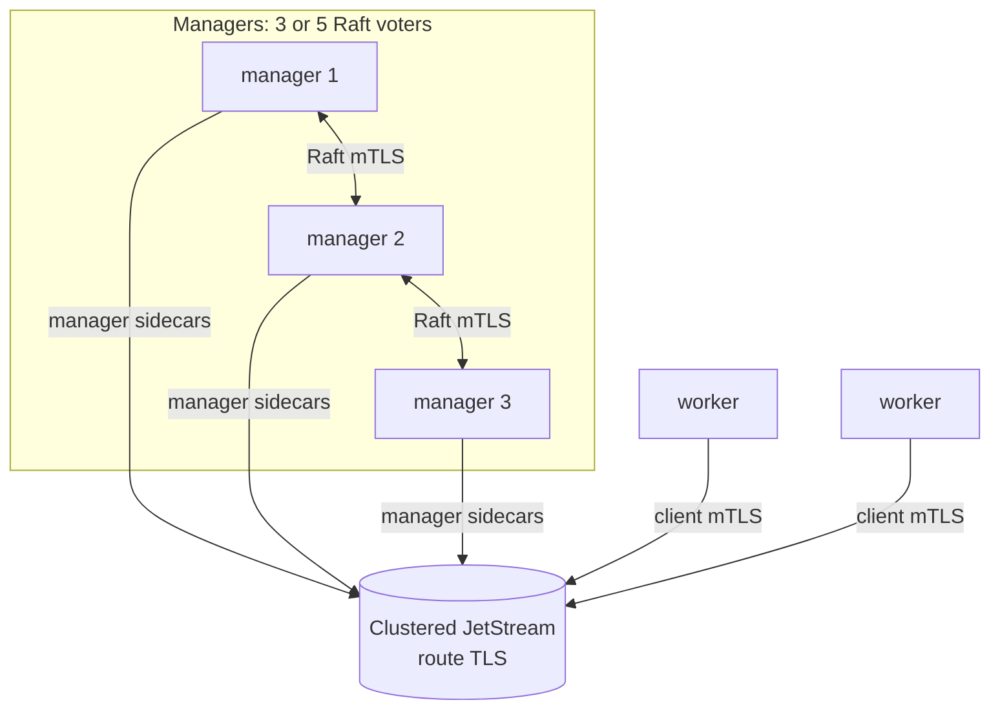

# Supported topologies

Which layouts the current manager-only Raft code supports, what each one needs,
and how far each has been verified. Commands and flags are in the [CLI
reference](cli.md).

| Topology | Status | Verified by |
| --- | --- | --- |
| [Single host](#single-host) | **Supported; Linux containerd smoke verified** | One manager process serves the API and runs tasks; restart and state export/import round-trip. |
| [Single host, operated from a workstation](#operating-from-a-workstation) | Supported | `minga-ctl` integration tests against a real API server in CI |
| [Air-gapped single host](#air-gapped) | Supported | The same binaries and steps as a single host; no separate validation run is recorded |
| [Talos Linux, single node](#talos-linux) | Supported | Docker-provisioned Talos v1.14.5 (arm64) through workload start; bare metal not validated |
| [Container image](#container-image) | Supported | Image verified on arm64 |
| [Multi-node](#multi-node) | **Supported; T2 and T3 live-verified** | Raft mTLS, NATS client/route mTLS, worker partition/rejoin, cross-node ingress, isolation and manager-relay failover on OrbStack Ubuntu VMs. T4 scale remains untested. |

Not supported: nodes running different versions and TLS on the API listener.
See [what is not supported](#not-supported) for alternatives and limits.

## Single host

One process on one Linux host. `minga manager` is the sole Raft voter and
serves the Docker Engine API:



| Process | Typical flags |
| --- | --- |
| `minga manager` | `--node-id 1 --bind 127.0.0.1:7001 --runtime containerd --metrics-bind 127.0.0.1:9100 --api-bind 127.0.0.1:2375`, with `MINGA_API_TOKEN` in its environment |

The [quick start](../README.md#quick-start-one-linux-host) starts one
manager; the [staging guide](hetzner-arm-staging.md#single-node-configuration)
configures one systemd unit.

**Ports on the host**

| Port | Bound by | Default | Reach from |
| --- | --- | --- | --- |
| Raft (`--bind`) | `minga manager` | required; one voter on a single host | Other managers. Keep it on 127.0.0.1 for this one-manager topology. |
| 2375 (`--api-bind`) | `minga manager` | `0.0.0.0:2375` | Operators and tools. Bind 127.0.0.1 unless containers such as Traefik must reach it, then set a token and firewall the port. |
| 4222, 8222 | the NATS sidecar | 127.0.0.1 only | The node itself. |
| `--metrics-bind` | `minga manager` | not served | Your monitoring. |
| `--egress-bind` | `minga manager` | not served | Agent tasks on the node. |
| Published task ports | iptables DNAT | per Compose file | Clients. |

From 1.2.0 a task cannot publish a port the node uses itself (53, the Raft,
metrics and egress ports, the sidecar's 4222 and 8222) or one a host process
already listens on: it fails with `port N is in use on this node`.

**Before going live**

- `--runtime containerd` on the manager (`--runtime` is required; `mock` runs nothing).
- An API token, in an `EnvironmentFile` with mode 0600, whenever the API is bound off loopback.
- Images present: pulled by containerd on first use, or preloaded with `minga image pull` or `ctr -n minga images import`.
- Secrets provisioned with `minga secret put` (or `minga-ctl secret put`) before the deploy that needs them.
- Back up with `minga state export` before upgrades; see [backup.md](backup.md).

## Operating from a workstation

`minga-ctl` reaches the node's API through an SSH tunnel and runs node-local
commands (secrets, images, registry logins, logs) over SSH. Nothing else needs
to be exposed:

```bash
minga-ctl context add site-a --ssh admin@site-a \
  --remote-token-file /etc/minga/minga-api.env --use
minga-ctl stack deploy -c compose.yaml shop
minga-ctl health --stack shop
```

The workstation needs the `minga` binary too, because `stack deploy` runs
`minga deploy` locally (release archives are Linux only; on macOS build it with
`cargo install --locked --path crates/minga-cli`). From 1.2.0, `stack deploy`
over SSH requires a token in the context. Plain HTTP to a non-loopback endpoint
is refused; use SSH or `https://` with `--tls-cert`.

## Air-gapped

The single-host layout, with nothing pulled at run time:

1. Copy the release archive (`minga`, `nats-server`, `ctr` and the licenses,
   checked against `SHA256SUMS`) and your image tarballs to the site.
2. On each node, `ctr -n minga images import <image>.tar`.
3. Start the roles as for a single host, and deploy.

No step needs a network connection. A service whose image is missing tries to
pull it and fails with that error, so import every image the Compose file
names.

## Talos Linux

A single node on Talos v1.14: Minga runs as two `ContainerConfig` containers
pulled from GHCR (no system extension and no custom boot asset), and a
Kubernetes Job preloads workload images with the bundled `ctr`. Follow
[talos-deployment.md](talos-deployment.md) and `scripts/setup-talos-minga.sh`.
Validated on docker-provisioned Talos v1.14.5 (arm64); bare metal and
multi-node Talos are not.

## Container image

`ghcr.io/lithqube/minga` runs the same binaries for container-first hosts. A
node role needs the host network, `NET_ADMIN` and `SYS_ADMIN` (or
`--privileged`), the containerd socket, the data directory mounted at the same
path, and `/run/netns` mounted with shared propagation. The
[README](../README.md#container-image) has the full `docker run`. On a systemd
host, the installer is the simpler path.

## Multi-node

Managers-only Raft, JetStream workers and cross-node container networking
support T2–T4 cluster shapes. T2 and T3 have live VM evidence; T4 has not
been load-tested. Cross-node tasks retain their network names and addresses
over a node-level WireGuard L3 mesh. After test credential updates, a later
manager-1 restart failed with an NATS authorization violation; verify rejoin
after credential changes before release.



| Shape | Managers | Workers | NATS | Operational behavior |
| --- | --- | --- | --- | --- |
| **T2 Edge site** | 1 | A few, on links that may drop out | One manager sidecar; workers connect as clients | Worker loss never stalls deploy. During a bus partition, existing tasks keep running; after the lease expires, replacements may run elsewhere. The returning worker stops copies no longer assigned to it. Manager loss preserves tasks but placement waits. |
| **T3 HA site** | 3 or 5 | Any number | Manager sidecars clustered with route TLS; set `--nats-replicas 3` on a three-server cluster. External NATS remains supported. | One manager and its sidecar can be stopped while the other two retain Raft and bus quorum. Managers can be added and removed while services run. |
| **T4 Large on-prem** | 3 or 5 | Up to about 5,000 (ADR 0001 target) | As T3, or external NATS | Workers add no Raft replication or heartbeat writes. The Phase 12 proof is functional; no 5,000-worker load test has been run. |

The T2 partition behavior is **at-least-once**: a disconnected worker may keep
running a task while its replacement starts elsewhere. Both copies can run
until the old worker reconnects and observes the smaller assignment set. This
is intentional; there is no per-service “never reschedule on lease loss”
option. See [ADR 0006](adr/0006-workers-leave-raft.md#11-bus-partitions-preserve-running-tasks).

**WireGuard mesh and routing mesh**

- Every manager in a multi-manager cluster needs a reachable UDP endpoint,
  normally `--wg-endpoint <address>:51820`. Workers may omit an endpoint and
  remain behind NAT; they keep outbound WireGuard sessions to managers.
- Worker pairs connect directly when at least one endpoint is reachable.
  Otherwise, the lowest-ID healthy manager relays their overlay traffic.
  Relays decrypt and re-encrypt packets, so managers can inspect relayed
  container payloads; treat managers as trusted.
- Ingress-published ports answer on every node and route to task backends
  across the mesh. `mode: host` remains node-local and preserves the client
  address. The mesh does not implement UDP hole punching.

**Managers**

- Bootstrap managers with unique `--node-id` values, mutually reachable
  `--bind` addresses, and `--peer` entries for the other initial voters.
- Join a running cluster with `minga manager --join`, then add the manager
  through authenticated `POST /minga/managers`. Remove it through
  `DELETE /minga/managers/{id}`.
- Use `--raft-tls-ca`, `--raft-tls-cert` and `--raft-tls-key` for manager
  Raft mTLS. Use route TLS on each clustered sidecar; `--nats-replicas 3`
  preserves event, status, lease and assignment data with one manager down.
- Tenant log streams (`MINGA_LOGS_<tenant>`) remain single-replica. Retained logs are unavailable while
  their hosting NATS server is down; they become available again when it
  returns. Do not treat the log stream as HA storage.

**External NATS compatibility**

- The release bundles nats-server v2.15.3. External NATS is tested on v2.14.10
  and v2.15.3; managers warn at startup when JetStream `api.level` is below 4.
  A below-floor server still connects, but Minga does not apply the
  50,000-consumer KV limit there.
- During a mixed-version NATS rollout, rejected KV consumer-limit updates are
  logged and deferred. Reconnect Minga managers after all servers are upgraded
  to retry the 50,000-consumer limit.
- Single-server and three-server upgrade proofs cover v2.10.22 to v2.15.3.
  The tested single-server store also reopened on v2.10.22 with assignment,
  status, lease and log data intact. v2.10.22 is not a supported external
  line; rollback evidence is specific to that proof.

**Workers**

- Workers have no Raft data, bind address or peer list. Connect to the
  managers’ NATS seed list with `--nats-url` and an mTLS client identity.
- A worker certificate can read only its own assignments and write only its
  own lease, status and log subjects. Token-only NATS mode is development-only
  and gives no isolation between workers.
- Keep the same Minga version on every node; upgrade the cluster in one
  maintenance window.

**Per-node state and limits**

- Pull or import images on each node that may run a service. Provision secret
  values and registry credentials on each such node.
- Named volumes live under that node’s `--data-dir/volumes`; a task moved to
  another node starts with an empty volume. Pin stateful services with a
  placement constraint.
- Cross-node networking requires WireGuard support in the Linux kernel and
  the `wg` tool. Managers in a multi-manager cluster need reachable UDP
  endpoints; NAT-isolated workers use manager relays. Keep manager hosts
  trusted because relay traffic is visible. Verify manager rejoin after test
  credential changes before release.

## Not supported

| Currently unsupported | What to do instead |
| --- | --- |
| A multi-manager cluster with a manager lacking a reachable WireGuard endpoint | Configure `--wg-endpoint` and allow its UDP listen port (default 51820) from every node. |
| Nodes on different Minga versions | Upgrade all nodes together. |
| TLS on the API listener | Reach the API through SSH (`minga-ctl`) or keep it on a trusted network with a token. |
| Read-only or per-user API access | One shared token; [ADR 0005](adr/0005-api-identity-and-roles.md) is the proposed design. |
| macOS or Windows nodes | Linux only; macOS is for building and running the CLIs. |
