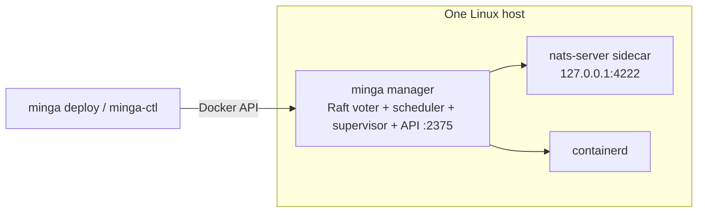
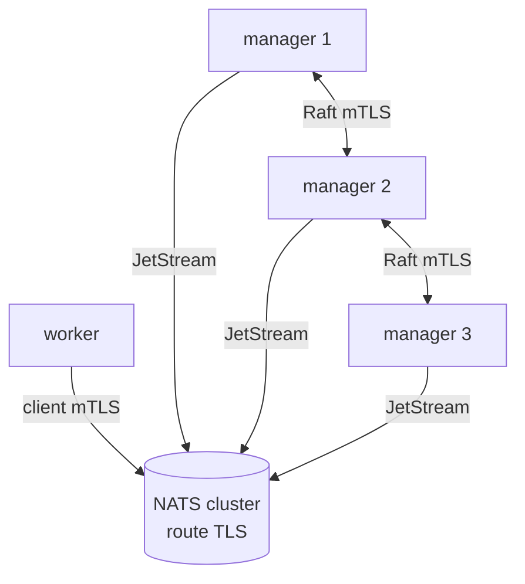

# Supported topologies

Which layouts the current manager-only Raft code supports, what each one needs,
and how far each has been verified. Commands and flags are in the [CLI
reference](cli.md).

| Topology | Status | Verified by |
| --- | --- | --- |
| [Single host](#single-host) | **Supported; single-process smoke verified** | Manager with mock runtime and the NATS sidecar on macOS: API deploy plus `state export`/`import` round-trip; Linux CI covers containerd networking, and the v1.1.0 staging setup used two processes (current CLI not yet staged). |
| [Single host, operated from a workstation](#operating-from-a-workstation) | Supported | `minga-ctl` integration tests against a real API server in CI |
| [Air-gapped single host](#air-gapped) | Supported | The same binaries and steps as a single host; no separate validation run is recorded |
| [Talos Linux, single node](#talos-linux) | Supported | Docker-provisioned Talos v1.14.5 (arm64) through workload start; bare metal not validated |
| [Container image](#container-image) | Supported | Image verified on arm64 |
| [Multi-node](#multi-node) | **Control plane only** | In-process multi-node tests in CI (Raft with mTLS, a NATS cluster); not validated on separate machines |

Not supported: containers on different nodes reaching each other, nodes running
different versions, and TLS on the API listener. See
[what is not supported](#not-supported).

## Single host

One process on one Linux host. `minga manager` is the sole Raft voter and
serves the Docker Engine API:



| Process | Typical flags |
| --- | --- |
| `minga manager` | `--node-id 1 --bind 127.0.0.1:7001 --runtime containerd --metrics-bind 127.0.0.1:9100 --api-bind 127.0.0.1:2375`, with `MINGA_API_TOKEN` in its environment |

The [quick start](../README.md#quick-start-one-linux-host) starts one
manager; the [staging guide](hetzner-arm-staging.md#single-node-configuration)
configures one systemd unit.

**Ports on the host**

| Port | Bound by | Default | Reach from |
| --- | --- | --- | --- |
| Raft (`--bind`) | `minga manager` | required; one voter on a single host | Other managers. Keep it on 127.0.0.1 for this one-manager topology. |
| 2375 (`--api-bind`) | `minga manager` | `0.0.0.0:2375` | Operators and tools. Bind 127.0.0.1 unless containers such as Traefik must reach it, then set a token and firewall the port. |
| 4222, 8222 | the NATS sidecar | 127.0.0.1 only | The node itself. |
| `--metrics-bind` | `minga manager` | not served | Your monitoring. |
| `--egress-bind` | `minga manager` | not served | Agent tasks on the node. |
| Published task ports | iptables DNAT | per Compose file | Clients. |

From 1.2.0 a task cannot publish a port the node uses itself (53, the Raft,
metrics and egress ports, the sidecar's 4222 and 8222) or one a host process
already listens on: it fails with `port N is in use on this node`.

**Before going live**

- `--runtime containerd` on the manager (the default `mock` runs nothing).
- An API token, in an `EnvironmentFile` with mode 0600, whenever the API is bound off loopback.
- Images present: pulled by containerd on first use, or preloaded with `minga image pull` or `ctr -n minga images import`.
- Secrets provisioned with `minga secret put` (or `minga-ctl secret put`) before the deploy that needs them.
- Back up with `minga state export` before upgrades; see [backup.md](backup.md).

## Operating from a workstation

`minga-ctl` reaches the node's API through an SSH tunnel and runs node-local
commands (secrets, images, registry logins, logs) over SSH. Nothing else needs
to be exposed:

```bash
minga-ctl context add site-a --ssh admin@site-a \
  --remote-token-file /etc/minga/minga-api.env --use
minga-ctl stack deploy -c compose.yaml shop
minga-ctl health --stack shop
```

The workstation needs the `minga` binary too, because `stack deploy` runs
`minga deploy` locally (release archives are Linux only; on macOS build it with
`cargo install --locked --path crates/minga-cli`). From 1.2.0, `stack deploy`
over SSH requires a token in the context. Plain HTTP to a non-loopback endpoint
is refused; use SSH or `https://` with `--tls-cert`.

## Air-gapped

The single-host layout, with nothing pulled at run time:

1. Copy the release archive (`minga`, `nats-server`, `ctr` and the licenses,
   checked against `SHA256SUMS`) and your image tarballs to the site.
2. On each node, `ctr -n minga images import <image>.tar`.
3. Start the roles as for a single host, and deploy.

No step needs a network connection. A service whose image is missing tries to
pull it and fails with that error, so import every image the Compose file
names.

## Talos Linux

A single node on Talos v1.14: Minga runs as two `ContainerConfig` containers
pulled from GHCR (no system extension and no custom boot asset), and a
Kubernetes Job preloads workload images with the bundled `ctr`. Follow
[talos-deployment.md](talos-deployment.md) and `scripts/setup-talos-minga.sh`.
Validated on docker-provisioned Talos v1.14.5 (arm64); bare metal and
multi-node Talos are not.

## Container image

`ghcr.io/lithqube/minga` runs the same binaries for container-first hosts. A
node role needs the host network, `NET_ADMIN` and `SYS_ADMIN` (or
`--privileged`), the containerd socket, the data directory mounted at the same
path, and `/run/netns` mounted with shared propagation. The
[README](../README.md#container-image) has the full `docker run`. On a systemd
host, the installer is the simpler path.

## Multi-node

Raft, placement and the bus work across nodes; **container networking does
not**. Containers on different nodes cannot reach each other yet (there is no
WireGuard mesh), so a multi-node cluster today is for spreading independent
stacks across nodes, not one stack whose services talk across nodes.



**Managers**

- Each manager needs a unique `--node-id`, a `--bind` address reachable by the
  other voters, and an initial `--peer` entry for every other voter when bootstrapping.
  A joining manager uses `--join` and is added through the authenticated API.
- Raft TLS: `--raft-tls-ca`, `--raft-tls-cert` and `--raft-tls-key`, from
  `minga tls init-ca` and `minga tls issue-node` (keys 0600). Without it,
  anything that reaches a Raft port can rewrite cluster state; Minga only logs
  a warning.
- Use the same external NATS cluster, or route-TLS sidecars on each manager.
  Set `--nats-replicas 3` on managers with a three-server NATS cluster.

**Workers**

- Connect to the managers' NATS seed list with `--nats-url` and their
  certificate identity. Workers have no Raft bind, peer list, or Raft data.
- Token-only NATS mode is development-only and does not isolate workers.
- The same Minga version must run on every node. Upgrade all nodes together.

**What stays per node**

- Images: pull or import them on every node that may run the service
  (`minga-ctl image pull` covers the context's `--node` targets).
- Secret values: provision them on every node that may run the service
  (`minga-ctl secret put` does the same).
- Registry credentials (`minga-ctl registry login`).
- Named volumes: they live in that node's `--data-dir/volumes`. A task placed
  on another node starts with an empty volume, so pin stateful services with a
  placement constraint (`--label` on the node, `node.labels.*` in the Compose
  file).

**Limits today**

- Cross-node container networking is not available until the WireGuard mesh
  lands. Keep communicating services on one node with placement constraints.
- During a worker partition, a task can run on both the disconnected worker and
  its replacement until the worker reconnects. This is at-least-once delivery;
  see [ADR 0006](adr/0006-workers-leave-raft.md#11-bus-partitions-preserve-running-tasks).

## Not supported

| Currently unsupported | What to do instead |
| --- | --- |
| Containers on different nodes reaching each other | Keep services that talk to each other on one node with placement constraints. |
| Nodes on different Minga versions | Upgrade all nodes together. |
| TLS on the API listener | Reach the API through SSH (`minga-ctl`) or keep it on a trusted network with a token. |
| Read-only or per-user API access | One shared token; [ADR 0005](adr/0005-api-identity-and-roles.md) is the proposed design. |
| macOS or Windows nodes | Linux only; macOS is for building and running the CLIs. |
